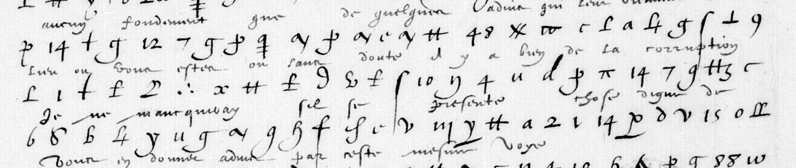

# Français 3516 — Brulart de Berny, f132r: excerpt

George Lasry, report PDF `50_francais-3516-brulart-de-berny-f132r.pdf`, "Excerpt and Translation".

## Excerpt 1 (f132r, cipher lines7–9)

**Aucun fondement que de quelques advis qui leur viennent du lieu où vous estes, où sans doute il y a bien de la corruption. Je ne manqueray, s’il se presente chose dig**[ne]…
