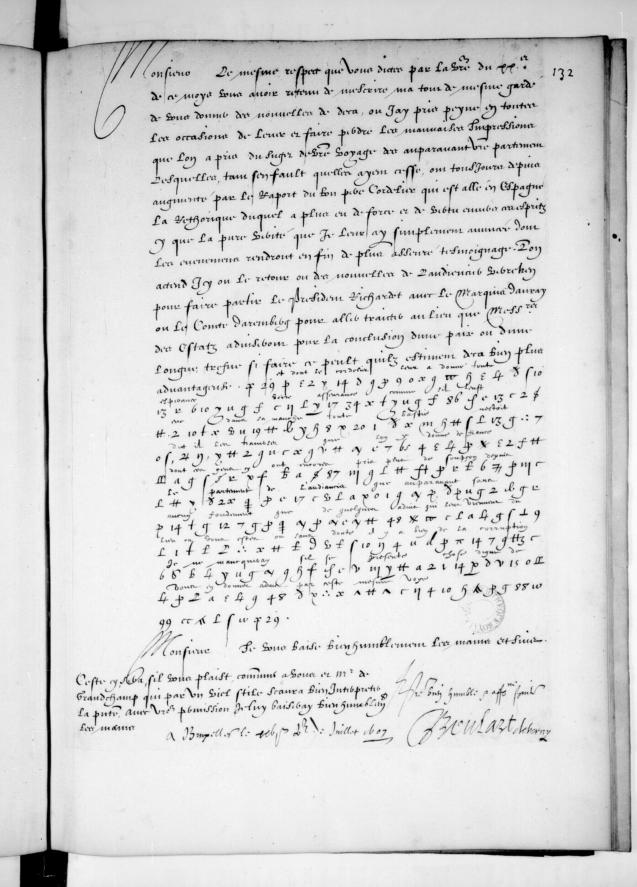

<!-- George Lasry, report PDF 50_francais-3516-brulart-de-berny-f132r.pdf (received 2026-10-24), "Readable text". Bold as in the PDF. -->

## f132r — System C

Monsieur, le même respect que vous dites, par la vôtre du vingtième de ce mois, vous avoir retenu de m’écrire, m’a tout de même gardé de vous donner des nouvelles de deçà, où j’ai pris peine en toutes occasions de lever et faire perdre les mauvaises impressions que l’on a prises du sujet de votre voyage, dès auparavant votre partement; lesquelles, tant s’en faut qu’elles aient cessé, ont toujours depuis augmenté par le rapport du bon père cordelier, qui est allé en Espagne; la rhétorique duquel a plus eu de force et de vertu envers ces esprits-ci, que la pure vérité que je leur ai simplement annoncée, dont les événemens rendront enfin de plus assurés témoignages. L’on attend ici ou le retour ou des nouvelles de l’audiencier Verreiken, pour faire partir le président Richardot avec le marquis d’Itaures, ou le comte d’Aremberg, pour aller traiter au lieu que messieurs des Etats aviseront pour la conclusion d’une paix, ou d’une longue trève, si faire se peut, qu’ils estiment deçà bien plus avantageuse; [?] **et dont le cordelier leur a donné toutte esperance, voire asseurance, comme s’il l’eust eue dans sa manche toute bastie, n’estoit, dit-il, les traverses que l’on y donne de France dont ces gens cy ont encore pris plus de soupçon depuis le partement de l’audiencier qu’auparavant sans aucun fondement que de quelques advis qui leur viennent du lieu où vous estes, où sans doute il y a bien de la corruption. Je ne manqueray, s’il se presente chose digne, de vous en donner advis par seeste mesme voye.** [?] Monsieur, je vous baise bien humblement les mains, et suis votre bien humble et affectionné serviteur, Brulart et de Berny. De Bruxelles, ce26juillet1607.

Manuscript source

Jeannin (1875), p.104

et dont le cordelier leur a donné toute espérance, voire assurance, comme s’il l’eût eue dans sa manche toute bâtie, n’étoit, dit-il, les traverses que l’on y donne de France dont ces gens-ci ont encore pris plus de soupçon depuis le partement de l’audiencier, qu’auparavant sans aucun fondement que de quelques avis qui leur viennent du lieu où vous êtes, où sans doute il y a bien de la corruption. Je ne manquerai, s’il se présente chose digne, de vous en donner avis par cette même voie.

Published page image
