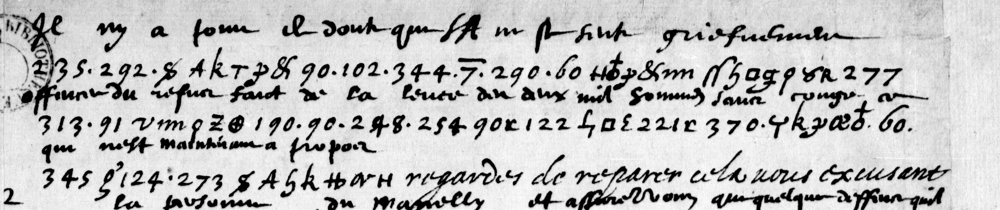

# Français 3822: excerpt

George Lasry, report PDF `35_francais-3822.pdf`, "Excerpt and Translation".

## Excerpt 1 (f133r, three complete manuscript lines)

**Il n’y a point de doubte que S.A. ne ce sente griefvement offensé du refus faict de la levée des deux mil hommes sans congé ce qui n’est maintenant à propos.** Regardez de reparer cela vous excusant…
