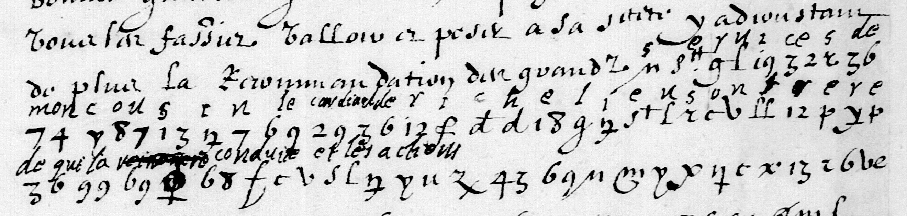

# Français 3675 — Louis XIII à Béthune, 30 juin 1629: excerpt

George Lasry, report PDF `41_francais-3675-louis-xiii-a-bethune-30-juin-1629.pdf`, "Excerpt and Translation".

## Excerpt 1 (f53r, three complete cipher-bearing rows and preceding cleartext)

vous les fassiez valloir et peser à sa Saincteté y adjoustant de plus la recommandation des grands **services de mon cousin le cardinal de Richelieu son frere de qui le [passage rayé] la conduicte et les actions sont**
