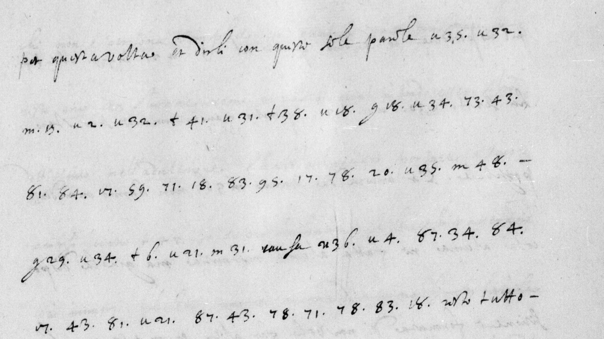

# Italien 2061 — ff72v–73r, 95v–96r, 97v–98r: excerpt

George Lasry, report PDF `53_italien-2061-ff72v73r-95v96r-97v98r.pdf`, "Excerpt and Translation".

## Excerpt 1 (f73r, first five complete body lines)

per questa volta, et dirli con queste sole parole **Che Dal** **Villeroy et Dal Amb.r Del Re Qui E Con querimonia Che F.P.** **Communica Con Riformati Di Francia** causa **Perche Non scriue Di sua mano** resto tutto
