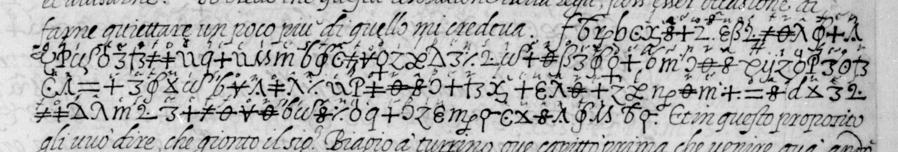
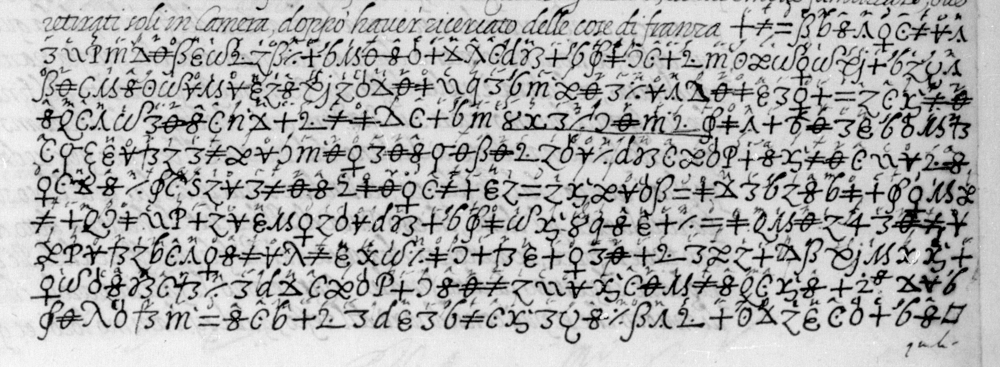
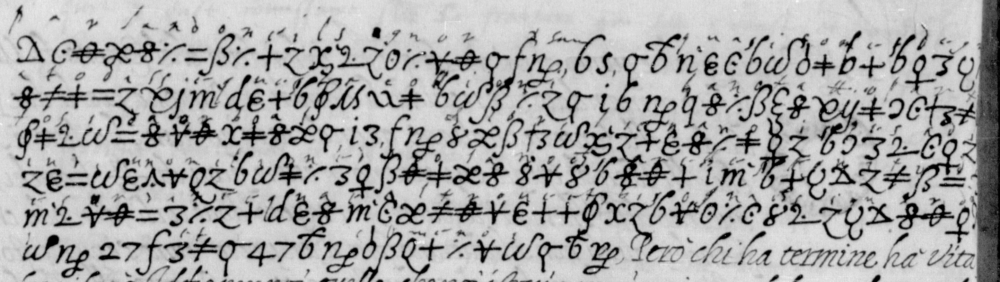
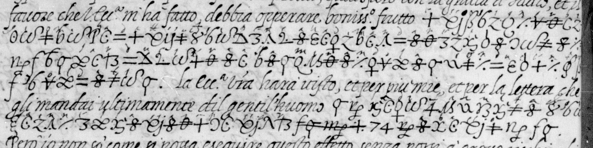
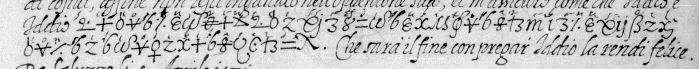
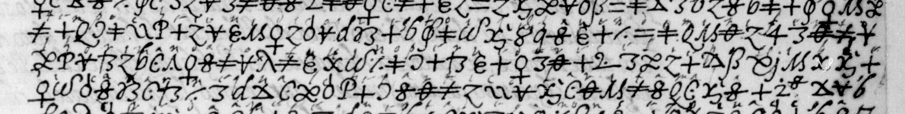

# Français 3252 — ff36r–37r: excerpt

George Lasry, report PDF `56_francais-3252-ff36r37r.pdf`, "Excerpt and Translation".

## Excerpt 1 (f36r, three complete cipher lines 7–9)

…**tempo che io ui dico questo il ? hauendomi riferto l'ho rimandato a Turino per uedere se li e posible di cauarne qualche particolarita, ma la E.sa Vos…**
