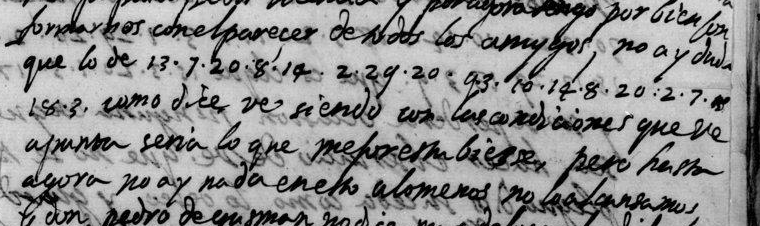
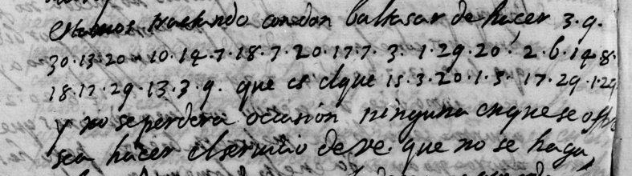

# Français 23054 — Blasco, 2 May 1597: excerpt

George Lasry, report PDF `13_francais-23054-blasco-2-may-1597.pdf`, "Excerpt and Translation".

## Excerpt 1 (f72r)

por fuerça [?] con el parecer de todos los amigos. No ay duda que lo de **venir con la princesa** como dize V. E., siendo con las condiciones que V. E. apunta, seria lo que mejor estuviesse, pero hasta agora no ay nada en esto, a lo menos no lo sabemos.

## Excerpt 2 (f72v)

Estamos tratando con don Baltasar de hacer **algun presente a don Christoual**, que es el que **mand[a] todo**, y no se perdera ocasion ninguna en que se ofrezca hacer el servicio de V. E. que no se haga.
