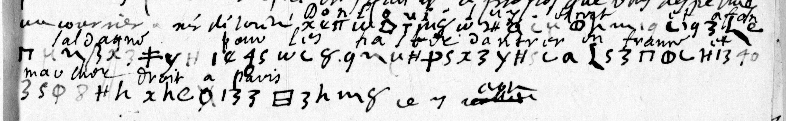

# Clairambault 460 — graphic cipher, pp53–55: excerpt

George Lasry, report PDF `25_clairambault-460-graphic-cipher-pp5355.pdf`, "Excerpt and Translation".

## Excerpt 1 (p55 — postscript)

un courrier à Mr de Condé? **Don Louis lui escrit et à Fonsaldagne pour les haster d'antr[er] en France et marcher droit à Paris.**
