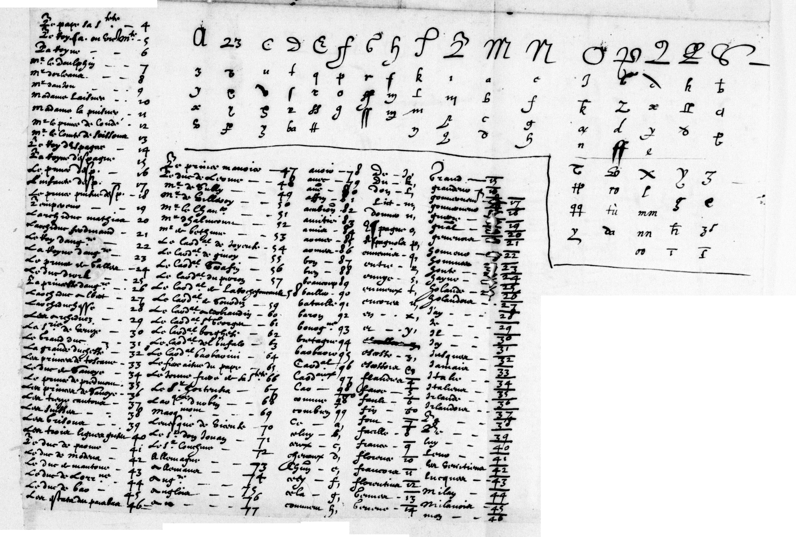
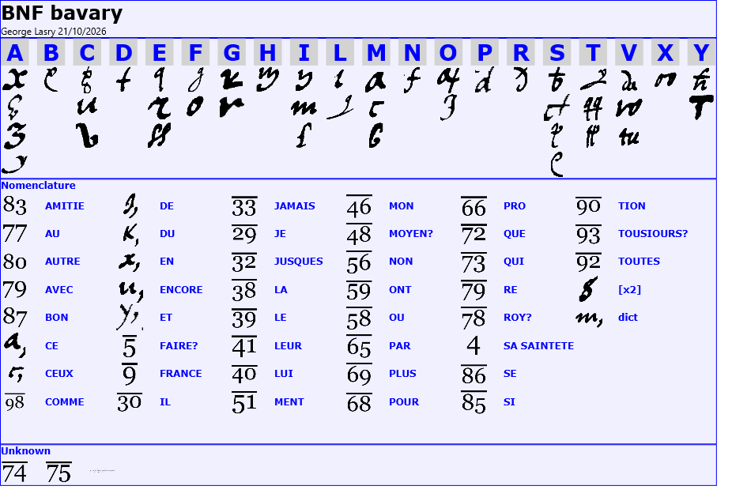
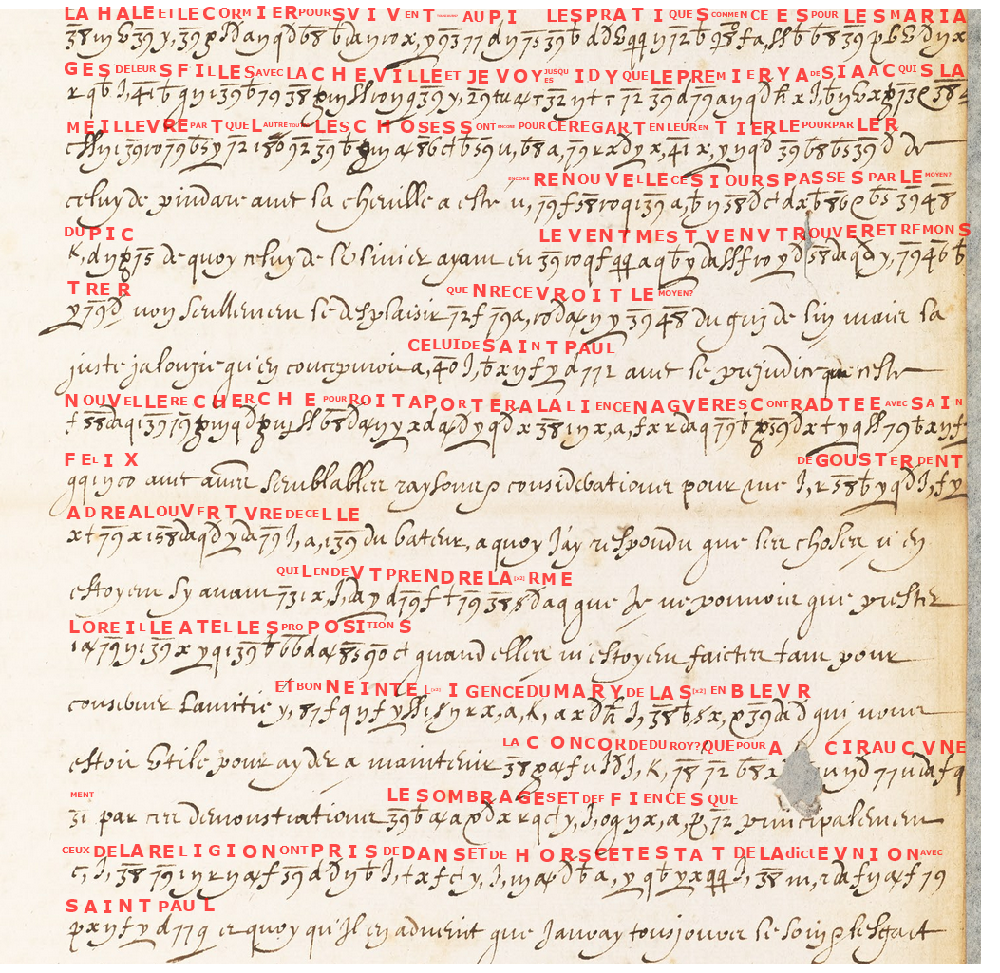
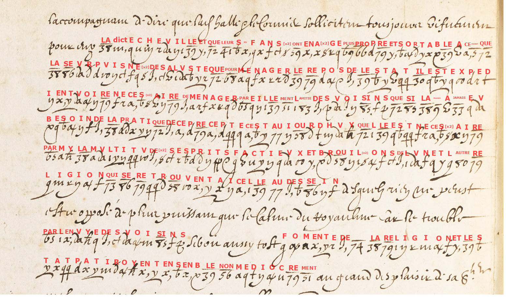
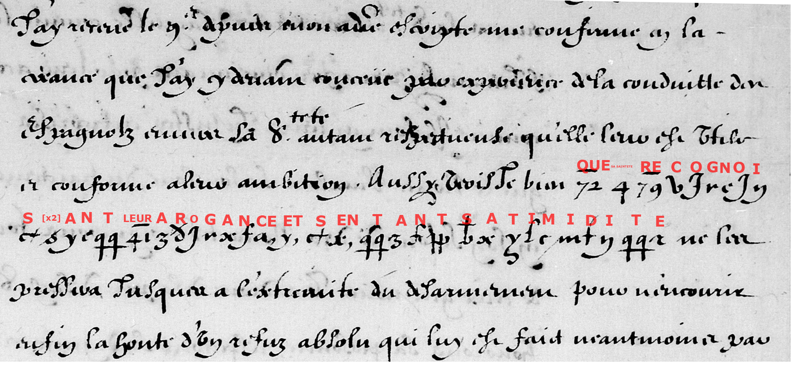

# Savary / Brèves: an improved reading of the larger letter and refined glyph attribution

George Lasry deciphered the additional document in 2022 using CTTS (CrypTool Transcriber and Solver). The transcription, key and decryption were improved with Opus 5.5 in October 2026. Codex prepared this edition, translated the visible text, compared the scans and checked the mechanical key application.

Brice Dudout, working with Claude and Codex, deciphered the Marie de Médicis passages in October 2026; Satoshi Tomokiyo contributed key identifications and checks. Daniel Bourdeau published and checked that work in the breves1610 entry on 20 October. For the November passage, this contribution refines the attribution of glyphs to plaintext values, particularly the repeat sign; the French reading is essentially unchanged.

## Scope and prior coverage

This supplement belongs with `targets/breves1610/`; it does not establish another ledger entry for the same key. The three supplied images represent **two documents**, following Lasry’s clarification: `b1.bmp` and `b2.bmp` are the additional document, and `3.jpg` is the November 1610 excerpt. No new analysis of the 15 September 1610 letter is claimed.

The additional document discusses marriage negotiations under apparent aliases, the reaction to an alliance and the need for calm at home and friendship with neighbours. Its crops have no dates, addresses or signatures. Do not identify these two images with Henri IV’s 5 January 1610 letter R2077 without a matching archival image or other evidence. A search of the current repository’s generated text index found no Pindare, La Cheville, La Hale/Halle or Saluste reading. That is a limited coverage check, not proof of first publication.

George Lasry dates this CTTS decipherment to 2022. Cryptiana’s account separately dates a related R2077 decipherment by Lasry, assisted by Biermann and Tomokiyo, to 2021. These are recorded separately, not silently harmonized. Lasry’s 2022 attribution applies to the additional document supplied here.

## Contribution and relation to Dudout’s reading

1. **More accurate glyph attribution in the November passage.** The French text is essentially the same as Dudout’s reading. The repeat operator explains the second s in recognoissant. CTTS `s-` is repeated across the two-image document. It gives LL in intelligence and brouillons, AA in aage, EE in puisnée, SS in necessaire, and repeats whole elements: LA + repeat in l’alarme, DE + repeat across multitude des esprits. The corresponding sign after S in the November fragment therefore supplies another S. This directly addresses one uncertainty in the 20 October sign-by-sign review.
2. **The glyph-to-plaintext alignment is made explicit.** CTTS `3 d- j v x f a,` gives A R O G A N CE, matching the French word in Dudout’s reading.
3. **The other document is supplied in full for the visible portions.** Both images receive a French edited reading, an English translation, the original transcription and an independently reproduced literal decode. This is the substantive added material.

**Still unsettled:** the C homophone `b` in recognoissant occurs only in the November fragment. The longer images cannot by themselves resolve the archive table’s B/C discrepancy. The November passage is improved, not asserted to be free of every paleographic uncertainty. The key remains partial: 74̄ and 75̄ are unknown; FAIRE?, MOYEN?, ROY? and TOUSIOURS? retain their question marks.

## Material

- [Offline illustrated edition](index.html): Full French text with deciphered passages in bold, followed by the English translation, uncertainty notes and the red CTTS overlays.
- [French reading](reading_fr.txt) and [English translation](translation_en.txt).
- [Current CTTS key](ctts/key.txt), [machine-readable key](key.json), [alignment](alignment.tsv), [verification](verification.json).
- `ctts/`: contributor’s original key, symbol labels, positions, transcription, decryption and edited text, copied byte for byte. `mechanical_*.txt` and `continuous_*.txt` are regenerated from this key; they preserve spelling and cleartext placeholders.
- [Source manifest](source_manifest.json): input SHA-256 hashes and modification timestamps. Original JPG images and CTTS PNGs are included at Lasry’s explicit request. The two BMPs as submitted were replaced on merging (21 Oct 2026) by their lossless PNG copies (pixel-identical; the manifest keeps the BMPs’ checksums), and the CTTS PNGs were recompressed losslessly.

### Original key assembled from the fragments

The fragments are registered through their overlapping glyphs and placed by integer translation. Their pixels are neither rescaled nor retouched. (On merging, 21 Oct 2026, the committed `original-key-assembled.png` was reduced to half size, 2219 × 1499, from 8.9 MB; `python assemble_key.py` rebuilds the full 4438 × 2998 image pixel for pixel from the fragments and `original-key-assembly.json`.) Blank areas fall outside the supplied fragments. The individual fragments are retained in `assets/key-fragments/`, and [assembly details](original-key-assembly.json) record the placements.

### Horizontal key

### Red decryption snapshots

The snapshots are the contributor’s current CTTS exports. The edited reading separately corrects cleartext readings and expands the repeat operator. A snapshot is not evidence that each questionable code is certain.

## Editorial review and qualifications

The contributor’s CTTS edits are preserved verbatim in `ctts/edited/`. The independent edition adopts image-supported Pindare (not Vendosme?), prester l’oreille (not rejetter?), and desquels (not de Lesdiguières?). It omits the unsupported rompu after a esté. The last line of image 1 reads le soing et l’effect, but the sentence continues beyond the image. Icy, alliance, contractée and entendre are editorial normalizations of imperfect cipher spelling/transcription. The damaged part of a[dou]cir is bracketed. The first two cleartext lines of 3.jpg and the connecting syntax in b2 line 9 remain uncertain. The translation carries these limits and does not expand beyond the images.

These corrections are independent Codex checks of the primary images. The supplied October CTTS key and reading are Lasry/Opus material adopted as a base, with the discrepancies above documented separately. Confidence is high for prester and desquels and for the repeat operator; provisional for L’Olivier, 48̄/78̄ and the connecting syntax. No source research files were edited.

## Verification

The position-label histogram exactly matches the transcription for each image. There are 805 cipher elements over all three images, including 11 repeat operators. `verification.json` gives the breakdown. Counts describe transcription coverage, not semantic accuracy. Every deterministic output in `alignment.tsv` is reproducible by [verify.py](verify.py), which also checks input checksums and local HTML links.

## Sources and credits

- Brice Dudout, [Marie de Médicis research dossier](https://bdudout.github.io/europe-chiffree/en/marie-de-medicis.html), updated 17 October 2026: solution of the September and November passages, with Claude and Codex; Satoshi Tomokiyo’s contribution. This supplement covers the November excerpt only.
- Daniel Bourdeau, [Marie de Médicis to Savary de Brèves, 1610](https://dbourdeau.github.io/cyphersolver/breves1610.html), posted 20 October 2026; the repository’s `NOTES.md`, `alignment.tsv` and `profile.json` were consulted read-only.
- Satoshi Tomokiyo, [French Ciphers during the Reign of Louis XIII](https://cryptiana.web.fc2.com/code/louisxiii.htm), section Regent Marie de Medici: the related earlier key recovery and R2077 context.
- [BnF Français 3789, view 36](https://gallica.bnf.fr/ark:/12148/btv1b9059628m/f36.item): November letter, stamped f. 19r; [BnF Français 3462, view 112](https://gallica.bnf.fr/ark:/12148/btv1b9058227h/f112.item): surviving key table.
- George Lasry, supplied CTTS project `BNF bavary`, current export of 21 October 2026. Original decipherment 2022; transcription, key and decryption improved with Opus 5.5, as confirmed by the contributor.

Credit requested: **George Lasry — earlier solution; transcription, key and decipherment contributed; improved with Opus 5.5.** Preserve Dudout’s solution credit and Tomokiyo’s and Bourdeau’s checks. No new statistical model-benchmark result is claimed.
