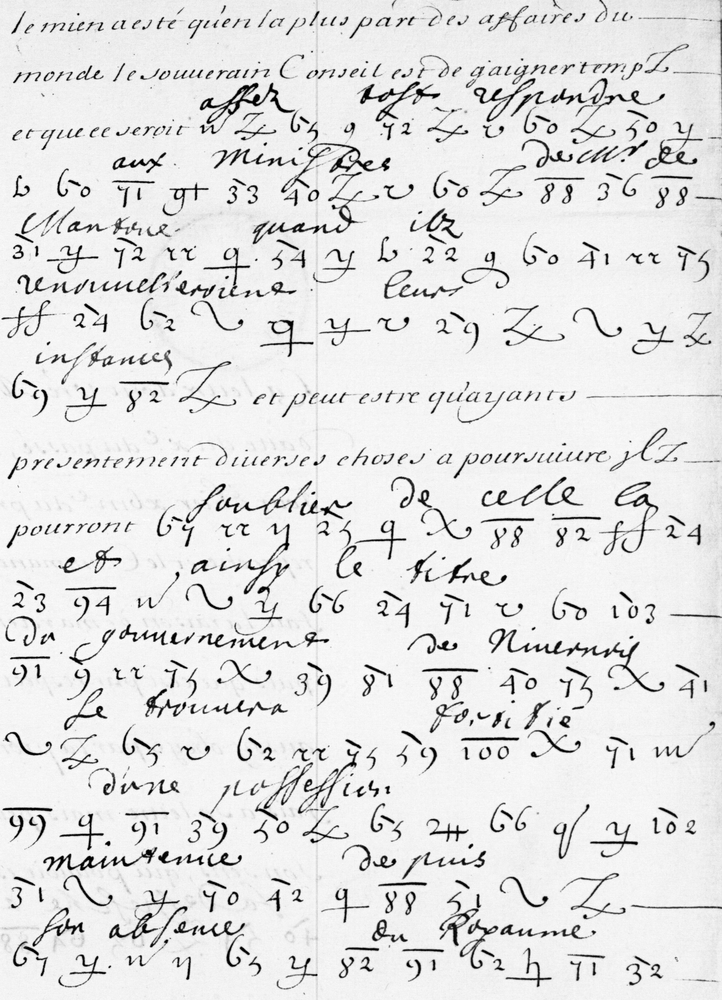

# Clairambault 1067: excerpt

George Lasry, report PDF `40_clairambault-1067.pdf`, "Excerpt and Translation".

## Excerpt 1 (f226v)

Le mien a esté qu’en la pluspart des affaires du monde le souverain conseil est de gaigner temps, et que ce seroit **assez tost respondre aux ministres de Monsieur de Mantoue quand ilz renouvelleroient leurs instances**; et peut estre qu’ayant presentement diverses choses à poursuivre ilz pourront **s’oublier de celle-là, et ainsi le titre du gouvernement de Nivernois se trouvera fortiffié d’une possession maintenue depuis son absence du Royaume**.
