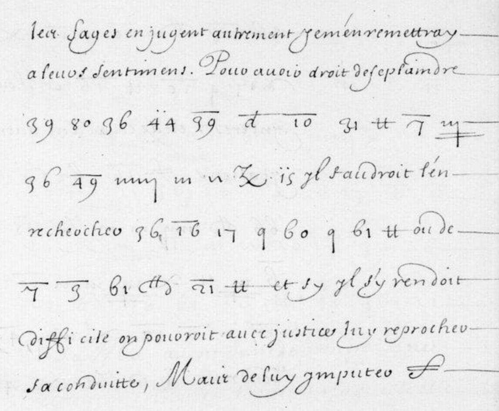

# Français 5160: excerpt

George Lasry, report PDF `38_francais-5160.pdf`, "Excerpt and Translation".

## Excerpt 1 (f18r)

Les sages en jugent autrement je m’en remettray à leurs sentimens. Pour avoir droit de se plaindre **du duc de Mantoue des graces qu'il depart aux Espagnols**, il faudroit l'en rechercher **de semblables** ou de **quipolentes**, et sy il s'y rendoit difficile on pouroit avec justice luy reprocher sa conduitte. Mais de luy imputer…
