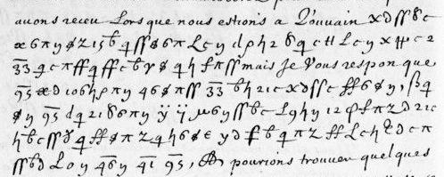

# Français 3758 — Châtillon, 3 August 1635: excerpt

George Lasry, report PDF `34_francais-3758-chatillon-3-august-1635.pdf`, "Excerpt and Translation".

## Excerpt 1 (f127v, cipher continuation)

**Cette consideration les pourra empescher de s’engager si avant,** mais Je Vous respon que **nous ne jouons point de ruse cete fois, mais nous passons le Rhin pour nostre plus grande seurete afin d’avoir se grand fleuve entre les ennemis et nous.**
