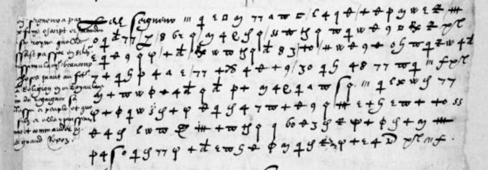

# Clairambault 1161: excerpt

George Lasry, report PDF `27_clairambault-1161.pdf`, "Excerpt and Translation".

## Excerpt 1 (f163r — complete eight-line cipher paragraph)

Ce Seigneur **a par deulx fois escript et mandé à ceste royne qu’elle laissast passer en silence et dissimulation beaucoup de choses quant au faict de la religion en ce royaume afin de regaigner sa noblesse et peuple, et que son filz et elle y puissent regner et commander en plus grand repos.**
