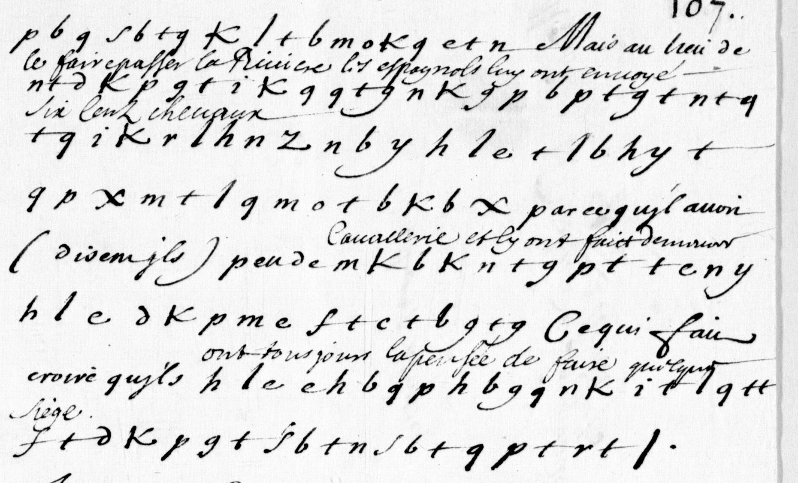

# Clairambault 460 — reciprocal alphabet: excerpt

George Lasry, report PDF `24_clairambault-460-reciprocal-alphabet.pdf`, "Excerpt and Translation".

## Excerpt 1 (p107 — complete cipher paragraph)

**jusques à Neufchastel** Mais au lieu de **le faire passer la riviere, les Espagnolz luy ont envoyé six cens chevaux**, parce qu'il avoit (disent ils) peu de **cavalerie et luy ont faict demeurer**. Ce qui fait croire qu'ils **ont tousiours la pensée de faire quelque siege.**
