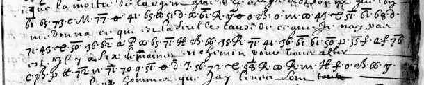

# Clairambault 460 — barred letters and numerals, pp285–: excerpt

George Lasry, report PDF `48_clairambault-460-barred-letters-and-numerals-pp285287.pdf`, "Excerpt and Translation".

## Excerpt 1 (p285, three complete cipher rows)

**Que la moitié de l’argent que Vre Al a ordonné que l’on me donna, ce qui est la seulle cause de ce que je nay pas esté il y a six semaine en chemin pour vous aller…**
