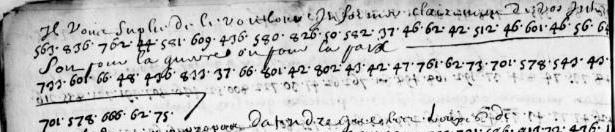

# Clairambault 460 — numerical cipher, pp289–303: excerpt

George Lasry, report PDF `49_clairambault-460-numerical-cipher-pp289303.pdf`, "Excerpt and Translation".

## Excerpt 1 (p296)

**Il vous suplie de le vouloir informer clairement de vos intentions, soit pour la guerre, ou pour la paix.**
