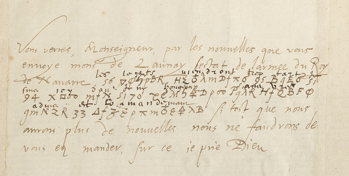
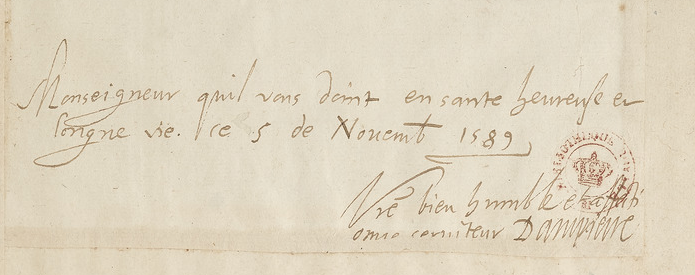

# Français 3414 — Dampierre, ff125r–125v: excerpt

George Lasry, report PDF `32_francais-3414-dampierre-ff125r125v.pdf`, "Excerpt and Translation".

## Excerpt 1 (f125r, complete first paragraph: three cipher rows with surrounding cleartext f125r, complete closing, date and signature (cleartext))

Vous verrez, Monseigneur, par les nouvelles que vous envoye monsieur de Launay l'estat de l'armée du Roy de Navarre. **Les legats viendront trop tart je sera icy d'ou je n'y bougeray sans vostre aduis et commandement**. Si tost que nous aurons plus de nouvelles nous ne fauldrons de vous en mander, sur ce je prie Dieu. Monseigneur, qu'il vous donne en santé heureuse et longue vie. Ce 5 de Novembre 1589. Vostre bien humble et affectionné serviteur Dampierre
