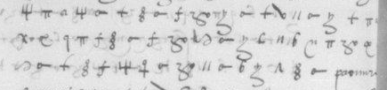

# Français 3142 — Du Bellay, ff60–61: excerpt

George Lasry, report PDF `43_francais-3142-du-bellay-ff6061.pdf`, "Excerpt and Translation".

## Excerpt 1 (f60v, three consecutive cipher rows (legacy A2–A4))

**toutes leurs espiez soubz couleur de [?] des Lutheriens et le**
