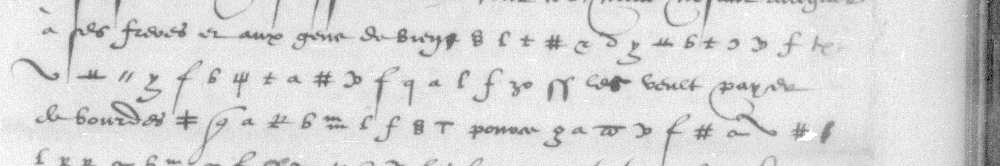

# Français 3142 — Du Bellay, ff65–66: excerpt

George Lasry, report PDF `11_francais-3142-du-bellay-ff6566.pdf`, "Excerpt and Translation".

## Excerpt 1 (f66r, cipher lines 10–12)

à ses freres et aux gens de Burgos **les raisons qui luy poisent sur le cueur il** les veult payer de bourdes **[?] devant eulx** pource **[?]**
