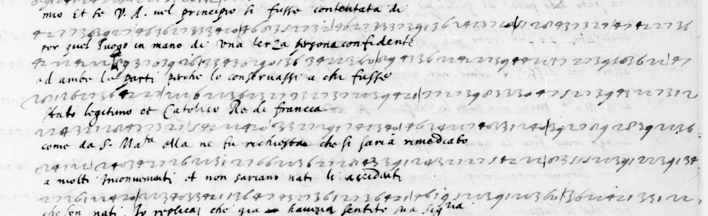

# Dupuy 155: excerpt

George Lasry, report PDF `20_dupuy-155.pdf`, "Excerpt and Translation".

## Excerpt 1 (f41r, rows9-14)

**[ante]cessore et nel mio. Et se Vostra Altezza nel principio fusse contentata di por quel luogo in mano di una terza persona confidente anbe le parti, perche lo conservassi a che fusse stato legitimo et Catolico Re di Francia, come da Sua Maesta ella ne fu richiesta, che si saria rimediato a molti inconvenienti et non sariano nati li a[ccidenti].**
