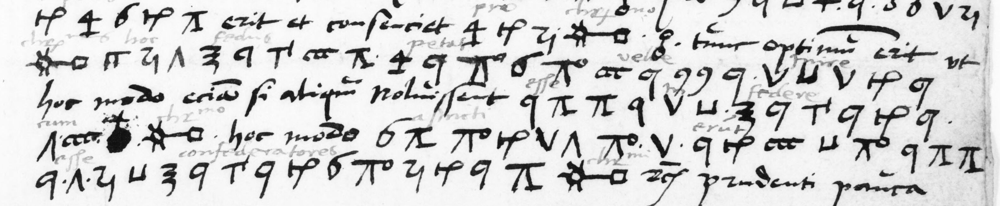

# Dupuy 468: excerpt

George Lasry, report PDF `29_dupuy-468.pdf`, "Excerpt and Translation".

## Excerpt 1 (f28r, final four cipher lines)

Tunc optimum erit ut **christianissimus hoc fedus petat velle inire**; hoc modo etiam si aliquando noluissent **esse in federe cu**[m] **christianissimo**, hoc modo **astricti erunt esse confederatores christianissimi.**
