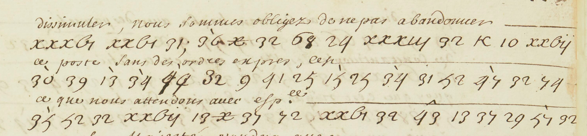

# NAF 22736 — Duquesne, ff137r–138r and144v: excerpt

George Lasry, report PDF `46_naf-22736-duquesne-ff137r138r-and144v.pdf`, "Excerpt and Translation".

## Excerpt 1 (f144v, first three cipher lines)

**…muler nous sommes obligez de ne pas abandonner ce poste ni ces lieux sans les ordres expres**
