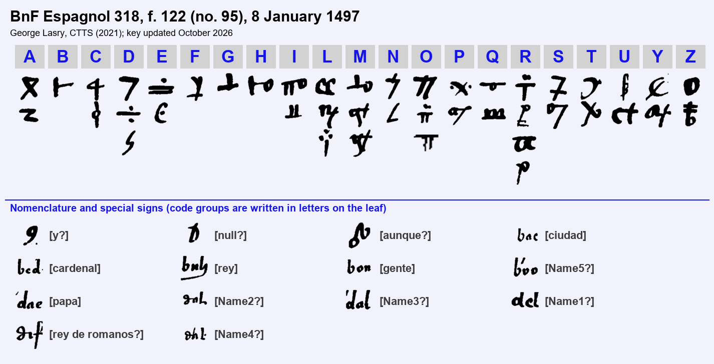
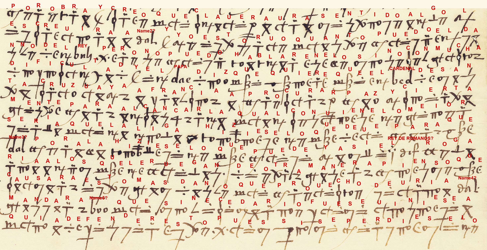

# BnF Espagnol 318, f. 122 (no. 95): a Spanish cipher letter from Italy, 8 January 1497

**Reference.** Bibliothèque nationale de France, Espagnol 318, f. 122r–v (no. 95), Gallica ark btv1b52503046q, views [458](https://gallica.bnf.fr/ark:/12148/btv1b52503046q/f458.item) (recto) and [459](https://gallica.bnf.fr/ark:/12148/btv1b52503046q/f459.item) (verso). Cyphersolver target `esp318no95`.

**Solved by Lasry with CTTS in 2021 and its built-in cryptanalysis.** The letter was transcribed in CTTS (CrypTool Transcriber and Solver), and the key was recovered with CTTS's built-in cryptanalysis. In October 2026 the key was revised with Claude Opus 5.5: two letter values were corrected, and the nomenclator groups were read from context where the text allows it. The whole letter is deciphered: the recto (33 lines on three overlapping photographs, 1,246 cipher tokens) and the verso (4 lines, 118 tokens). All 1,364 tokens are assigned. The reading is no longer approximate.

## Summary

- **From:** unknown, a Spanish agent in an Italian city (the city is named only by a code group).
- **To:** unknown, presumably a Spanish minister or ambassador.
- **Date:** 8 January 1497 (catalogue date; the date at the end of the verso, written in clear, reads *a viij de enero*; the year is not legible).
- **Content:** Famine grows in the city. Bread can hardly be had even for money. The French are sending food and offering the silk makers, a third of the **city**, licences to trade in France, hoping to win the **people** over. Troops and money are said to be coming from France. Meanwhile the **king** provides "very late and very little" and answers everything with words. The Signoria is willing but waits for the **king** to act. The writer has brought Messer Juan Luys to the city with great difficulty, and Juan Luys declares himself an enemy of France. The **[King of the Romans?]** negotiates daily with the governors and promises them great things. The writer does not expect agreement, since the governors keep him informed, although they hide from the **king**. They seem to want to govern as **[Name1?]** pleases and harbour hostile designs against the **king**. The **Pope** wants the **Cardinal** of Santa Cruz to go to France to negotiate peace. The writer thinks the League should do its part, and that **[Name4?]** should order **[Name5?]** to come and defend the city, for if it were lost, nothing in Italy would be safe. Of the **[King of the Romans?]** there is no news, except that he is in Germany, and nobody expects him to come back.

## The key

A homophonic substitution with a small nomenclator. The 21 letters A–Z (no J, K, V, W, X) have one to four symbols each, 44 in all. The nomenclator has 11 code groups, written on the leaf in ordinary letters (`bac`, `bed`, `bnh`, `bon`, `boo`, `dae`, `dah`, `dal`, `del`, `dif`/`def`, `dhl`), and three special signs.

In the nomenclature, plain readings are established from context, readings with ? are tentative, and [NameN?] and [TitleN] are placeholders for an unidentified person or title.

## Reading conventions

The whole letter is enciphered except the date at the end of the verso, shown in *italics*. **Bold** marks the nomenclator code groups, with their reading in brackets. [null?] marks a presumed null, … marks the turn of the page, and (?) marks a doubtful word. Spelling is kept as deciphered; punctuation, accents and word division are added.

## The letter — f. 122r (images f122a, f122b, f122c) and f. 122v (image f122v)

The three photographs overlap: the last two lines of f122a are repeated at the top of f122b. They are transcribed once, from f122b, the higher-resolution photograph; the text below follows the leaf once.

### Spanish

Y [null?] de lo de aquí no ay que dezir, remitiéndome a lo dicho, sino que crece cada día la carestía, y espérase que no se podrá aver pan por dinero ni sin él. Y los franceses traen muchas vituallas y licencia para los que hazen la seda, que es un tercio desta **[ciudad]**, que puedan mercadear en Francia; y piensan con estas dos cosas traer esta **[gente]** a su opinión. Y junto con esto diz que vienen con la más **[gente]** que pueden, y aun dinero; y **[aunque?]** el **[rey]** provee como suele, muy tarde y muy poco, todo lo quiere conplir con palabras. Y la Señoría parece que está dispuesta en esto, porque le toca mucho, pero espera a que el **[rey]** haga. **[y?]** Con esto están las cosas en no buen estado.

Y a micer Juan Luys avemos traído acá con harta fatiga, y muestra que está enemigo de Francia. Y el **[rey de romanos?]** cada día trata con estos que goviernan y les promete muy grandes cosas, pero no creo que se concertarán, pues que de todo me dan parte, aunque del **[rey]** se encubren. Y parece que se quieren governar como **[Name1?]** se sirva, y en al (?) grandes malos pensamientos contra el **[rey]**. No sé si pornán algo por obra. Y creo que Claver avrá sentido algo; lo escrevirá a **[Name2?]**. Y yo estorvo quanto puedo el daño del **[rey]**, pero no puedo hablar en ello sino con mucha dificultad.

Y el **[papa]** diz que quiere que el **[cardenal]** de Santa Cruz vaya a Francia a procurar paz. Y ciertamente, para alcançarla qual conviene, lo mejor sería que la Liga hiziese lo que deve, para que **[Name3?]** por allá hiziese lo que puede, y así el **[rey de romanos?]** rogaría a los que le ruegan; de otra manera pienso que causará esto más daño que provecho. Devría **[Name4?]** mandar a **[Name5?]** que, si necesario fuese, viniese aquí a defender esto, pues si se perdiese, lo …

*[f. 122v]* … que Dios no quiera, no avía cosa segura en Ytalia. Y del **[rey de romanos?]** no sé que diga, sino que está en Alemaña; y no supo nadie de su ida, ni ay esperança de su venida. *A viij de enero* [year not legible]. [rubric]

### English translation

And [null?] of matters here there is nothing to say, referring myself to what I wrote before, except that the dearth grows every day, and it is expected that bread will not be had for money or without it. And the French are bringing in many victuals, and a licence for those who make silk, who are a third of this **[city]**, to trade in France; and with these two things they mean to bring these **[people]** over to their side. And besides this, it is said that they are coming with as many **[troops]** as they can, and money too; and **[although?]** the **[king]** provides, as he usually does, very late and very little, he wants to settle everything with words. And the Signoria seems well disposed in this, because it concerns it greatly, but it is waiting for the **[king]** to act. **[And?]** With this, things are in no good state.

And we have brought Messer Juan Luys here with great difficulty, and he shows himself an enemy of France. And the **[King of the Romans?]** deals every day with those who govern and promises them very great things; but I do not believe they will come to terms, since they tell me everything, although they hide from the **[king]**. And it seems that they want to govern themselves as **[Name1?]** pleases, and [have?] great evil designs against the **[king]**. I do not know whether they will put anything into effect. And I believe that Claver will have sensed something; he will write it to **[Name2?]**. And I hinder the harm to the **[king]** as much as I can, but I cannot speak of it except with great difficulty.

And the **[Pope]** says that he wants the **[Cardinal]** of Santa Cruz to go to France to procure peace. And certainly, to obtain it as it should be, the best would be for the League to do what it ought, so that **[Name3?]** over there would do what he can, and so the **[King of the Romans?]** would entreat those who entreat him; otherwise I think this will do more harm than good. **[Name4?]** ought to order **[Name5?]** to come here, if it were necessary, to defend this place, for if it were lost, …

*[f. 122v]* … which God forbid, nothing in Italy would be safe. And of the **[King of the Romans?]** I do not know what to say, except that he is in Germany; and nobody knew of his going, nor is there any hope of his coming. *On 8 January* [year not legible]. [rubric]

## Notes on the reading

- Two values of the 2021 key were corrected in 2026. The small solid circle is Z, not B (*dezir*, *hazen*, *diz*, *paz*). The ℓ-shaped sign is R, not S (*aver pan*, *micer*, *Claver*).
- This reading agrees with Michael Brackx's independent reading of ll. 14–33 ([issue #63](https://github.com/dbourdeau/cyphersolver/issues/63)). It adopts his *avemos traído acá* in l. 14. The main differences are *rogaría a los que le ruegan* (his *logaría … llegan*), *para que* (his *parece que*), and *Claver avrá* (his *Claue haura*). On the verso, this reading agrees with Brackx except *no sé que diga* (his *que siga*). The verso's *del [def] … está en Alemaña; y no supo nadie de su ida* identifies the group as the King of the Romans, Maximilian I. The verso writes it `def` and the recto `dif`; they are treated as one group. One new sign appears on the verso, a plain π without dots, which is O (*no avía*).
- The two lines that f122a and f122b both show are transcribed once, from f122b. f122a lacks the B of *buen*, and f122b had no box for the C of *micer*; that box has been added.
- Open: `9` (l. 13, *[y?]*), `D` (presumed null), `oN` (*[aunque?]*), the word *en al* (l. 20, a burn hole according to Brackx), and the five unidentified code groups.

## Historical context

The letter dates from the pause after Charles VIII's Italian expedition. The League of Venice (31 March 1495) had joined Pope Alexander VI, Ferdinand and Isabella, Maximilian I, Venice and Milan against France. In the autumn of 1496 Maximilian came to Italy at the League's call, besieged Livorno and withdrew to Germany in December. The verso's remark that "nobody knew of his going, nor is there hope of his coming back" fits that moment. The winter of 1496–97 was a famine winter in much of Italy.

The city is not named; the code group `bac` stands for it. The evidence points to an important city that the French were courting: it has a Signoria, its silk workers are "a third" of its people, and it is so important that "if it were lost" nothing would be secure (verso). Genoa, then under Milanese rule and the object of French plans in 1497, fits best. "Micer Juan Luys" would then perhaps be Gian Luigi Fieschi. Neither identification is proven.

The Cardinal of Santa Cruz is the Spaniard Bernardino López de Carvajal, cardinal of Santa Croce in Gerusalemme from 1495. A Franco-Spanish truce was concluded within weeks of this letter (February 1497). The unqualified **king** is probably Ferdinand, the writer's master: the writer works to prevent harm to him, and the governors hide their plans from him.

Espagnol 318 (ex-Ruffo Scilla) gathers Spanish diplomatic letters of these years. Tomokiyo lists f. 122 among its "unidentified ciphers" and published an approximate solution "provided by George Lasry" in 2022. This contribution replaces that partial reading with a complete decipherment of the recto.

## Files

- `ctts/`: the CTTS project (colors, key, positions, transcription, decryption, edited readings, icons) for the recto photographs f122a–c and the verso f122v.
- `cryptiana/images/`: the key snapshot and the f122c decryption image.

## Sources

- BnF Espagnol 318, f. 122 (no. 95): [Gallica](https://gallica.bnf.fr/ark:/12148/btv1b52503046q/f458.item).
- A. Morel-Fatio, *Catalogue des manuscrits espagnols et des manuscrits portugais* (Paris, 1892), no. 172 (Espagnol 318).
- S. Tomokiyo, cryptiana: [Ciphers solved by George Lasry](http://cryptiana.web.fc2.com/code/GL.htm) (f. 122, no. 95, "approximate" solution, 2022) and [Spanish ciphers in the reign of Ferdinand and Isabella](http://cryptiana.web.fc2.com/code/spanish.htm) (Espagnol 318, unidentified ciphers).
- D. Bourdeau, cyphersolver target `esp318no95`: NOTES.md and f122_reading.md, including Michael Brackx's reading ([issue #63](https://github.com/dbourdeau/cyphersolver/issues/63), October 2026).
