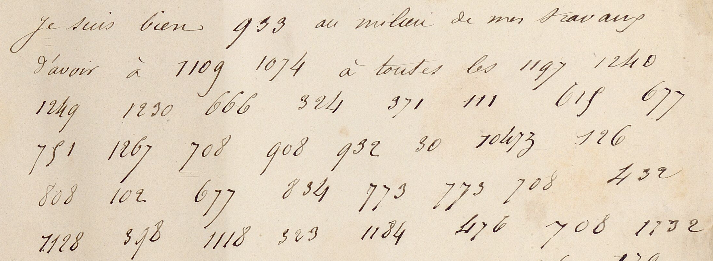
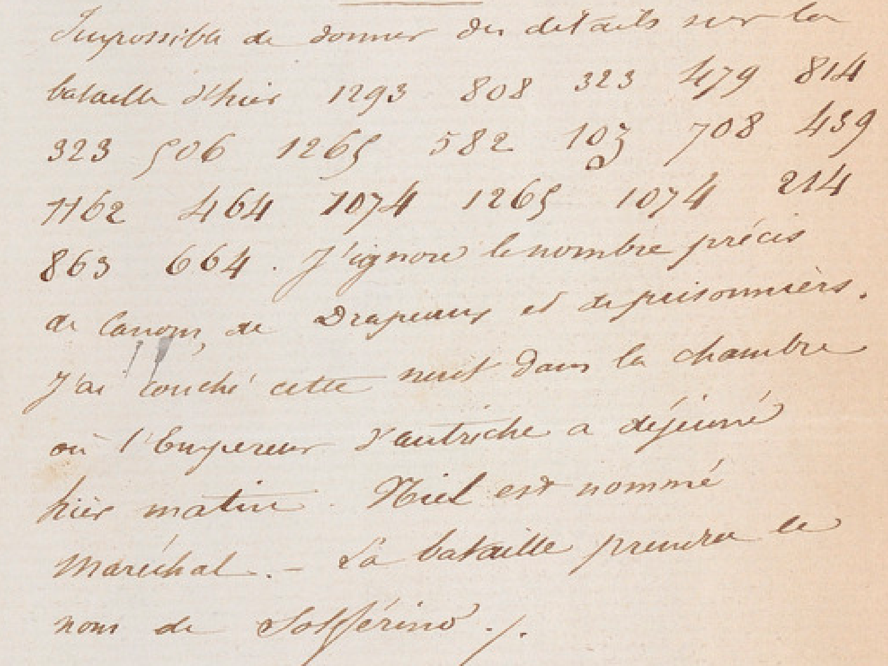
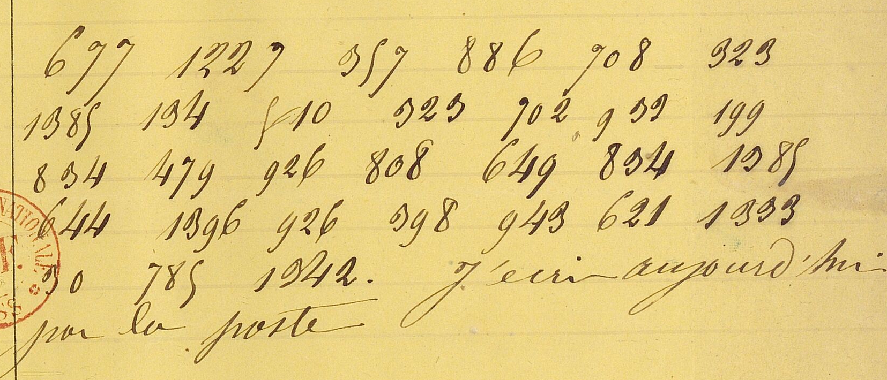

# NAF 11355 — Emperor–Empress code: excerpt

George Lasry, report PDF `08_naf-11355-emperorempress-code.pdf`, "Excerpt and Translation".

## Excerpt 1 (f19r — the Pope and diplomacy)

Je suis bien **peiné** au milieu de mes travaux d’avoir à **répondre** à toutes les **sotte[s] suppositions de la diplomatie. Je maintiens le pape à Rome avec mon armée. Je ne me mêle en rien du reste de ses États.**

## Excerpt 2 (f35r — the battle and the Austrian emperor’s room)

Impossible de donner des détails sur la bataille d’hier. **Tout** [le] **monde était mort de fatigue. L’ennemi s’est retiré cette nuit.** J’ignore le nombre précis de canons, de drapeaux et de prisonniers. J’ai couché cette nuit dans la chambre où l’Empereur d’Autriche a déjeuné hier matin. Niel est nommé Maréchal. La bataille prendra le nom de Solférino.

## Excerpt 3 (f27r — Eugénie’s message)

**Je suis désolée de vous avoir fait de la** **peine,** **ce n’était? pas mon intention. Ne vous inquiétez pas du petit, il va à merveille.** J’écris aujourd’hui par la poste.
