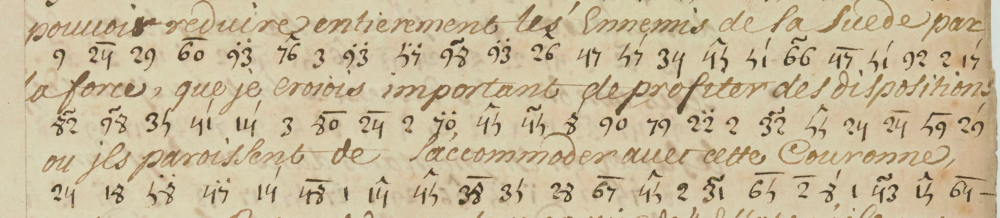

# NAF 22738: excerpt

George Lasry, report PDF `39_naf-22738.pdf`, "Excerpt and Translation".

## Excerpt 1 (f156r, lines6–8)

**pouvoir reduire entierement les ennemis de la Suede par la force, que je crois important de profiter des dispositions où ils paroissent de s’accommoder avec cette Couronne,**
