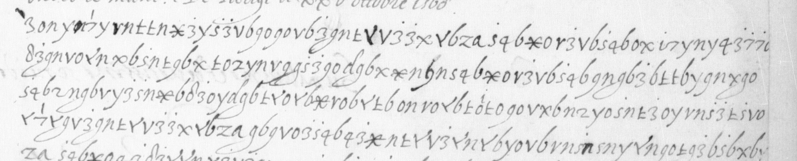
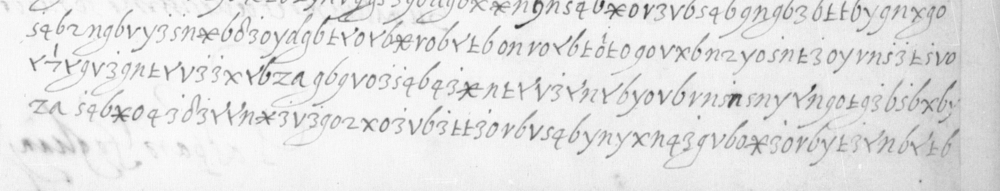
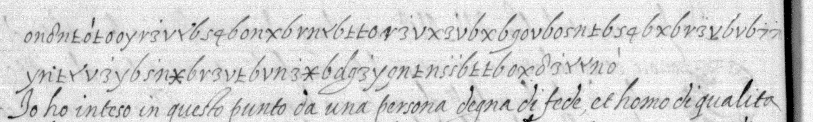

# Français 3234: excerpt

George Lasry, report PDF `03_francais-3234.pdf`, "Excerpt and Translation".

## Excerpt 1 (f103r, cipher lines1–3; saved editorial reading — 103r)

**Io n[o]n posso mancare di dire a uostra alteza che mi pare che il [?] non habb[i?] fauorito le cos[e] del signor duca di quel modo che mi pare che douea, essendo lui che gouerna come fa in questi tempi, et se io pitessi dirle ogni cosa in poca scri…**

## Excerpt 2 (f103r, cipher lines R3–R5)

**…che gouerna come fa in questi tempi, et se io pitessi dirle ogni cosa in poca scrittura, uostra alteza uedria che ha mostratto tenire poco conto di sua ecelenza, che mi ha fatto marauigliare assai, perche non lo haurei mai pensato, e[t] se…**

## Excerpt 3 (f103v, cipher lines V1–V2)

**io fossi in parte che io le potessi parlare, le direi cose che le parerebb[o]no strane, come parsero a me quando soccesse il fatto.** Io ho inteso in questo punto da una persona degna di fede et homo di qualita…
