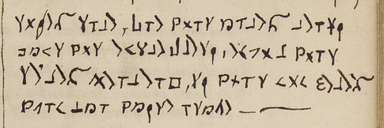
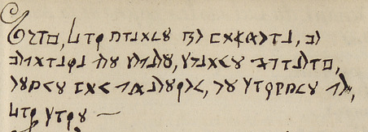

# Français 14765 — p351: excerpt

George Lasry, report PDF `06_francais-14765-p351.pdf`, "Excerpt and Translation".

## Excerpt 1 (p351)

**soies sure, que vous aures reusi dans vos entrepresi, enco[r] vous seres heureux, si vous non feres acun mau vaise usage —**

## Excerpt 2 (p351)

**Ceux, qui auront le bonheur, de décou[v]rir cet secret, seront heureux, etant bon chretien, et suivant ce, qui suit —**
