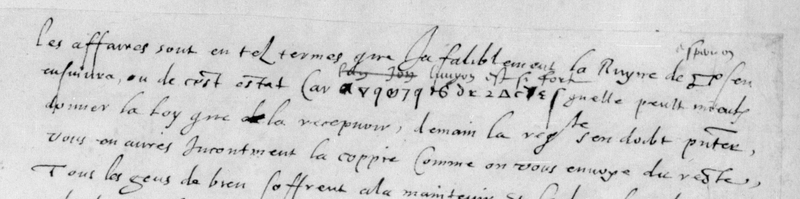

# Français 3321: excerpt

George Lasry, report PDF `31_francais-3321.pdf`, "Excerpt and Translation".

## Excerpt 1 (f103r, first four lines)

Les affaires sont en tel termes qu'infalliblement la Ruyne de **Espernon** s'en ensuivra, ou de cest estat. Car **l'union est si forte** qu'elle peult mieux donner la loy que la recepvoir. Demain la req[ueste] s'en doibt partir, vous en aurez Incontinent la coppie Comme on vous envoye du reste.
