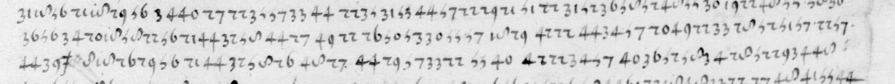
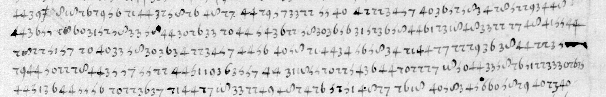
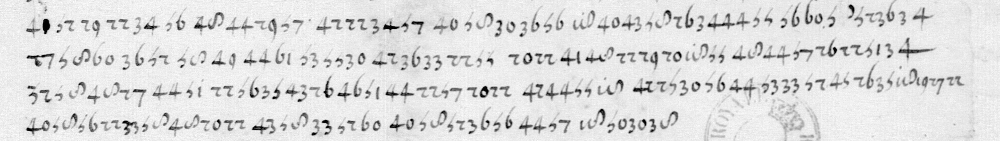

# Français 3575 — f56r: excerpt

George Lasry, report PDF `04_francais-3575-f56r.pdf`, "Excerpt and Translation".

## Excerpt 1 (f56r, L07–L09 — 56r)

**…pas dans sa lettre et pretend ne povvoir obeir. Vovs scaves de qvelle importance est Clermont et ez [m]ains de qvi il entrera. C’est à vovs, Monsi…**

## Excerpt 2 (f56r, cipher lines L09–L13)

**ez [m]ains de qvi il entrera. C’est à vovs, Monsievr, à y povrveoir, ce qve vovs povvez faire librement car vovs estes av dessvs de l’envye, et ne me mettre en bvtte parce qve cela me rvineroi[t] envers cevx de la religion. Il i a avssy vn afa…**

## Excerpt 3 (f56r, L19–L22 — 56r)

**[b]on essient. C’est à vovs à adviser sy vovs lvy vovlez procvrer ce bien car ie tiens qv’il en est digne et ce cera chose profitable av service dv roy, à vovs et à moy.**
