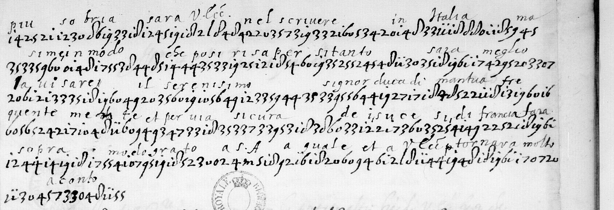

# Français 4696 — numerical cipher, ff54r–55r: excerpt

George Lasry, report PDF `44_francais-4696-numerical-cipher-ff54r55r.pdf`, "Excerpt and Translation".

## Excerpt 1 (f55r, full cipher lines 1–6)

**Piu sobria sara V.Ecc. nel scriuere in Italia, masime in modo che posi risapersi tanto. Sara meglio l’auuisare il serenisimo signor duca di Mantua frequentemente et per uia sicura de i sucesi di Francia. Sara sopra modo grato a S.A. a quale et a V.Ecc. tornara molto a conto.**
