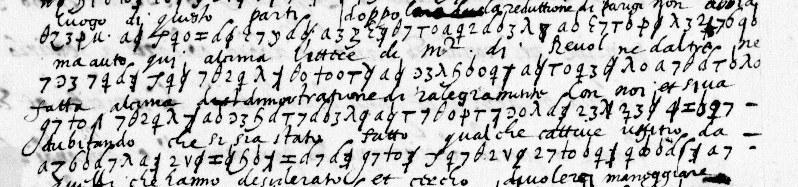

# Français 4700 — Gondi symbol cipher, ff9r–10r: excerpt

George Lasry, report PDF `37_francais-4700-gondi-symbol-cipher-ff9r10r.pdf`, "Excerpt and Translation".

## Excerpt 1 (f9v, rows 10–13)

**luogo di queste parti doppa la reductione di parigi non abbiamo auto qui alcuna lettere di monsieur di reuol ne daltri ne fatta alcuna dimostratione di ralegramento con noi et si ua dubitando che si sia stato fatto qualche cattiuo uffitio da**
