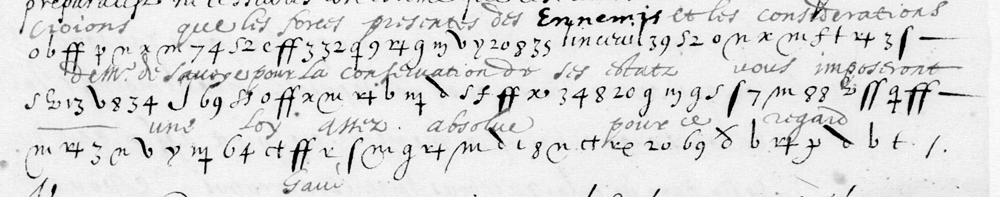

# Français 3944: excerpt

George Lasry, report PDF `36_francais-3944.pdf`, "Excerpt and Translation".

## Excerpt 1 (f99r, three complete cipher rows)

**croions que les forces presentes des [Ennemis] et les considerations de M. de Savoye pour la conservation de ses estats nous imposeront une loy assez absolue pour ce regard**
