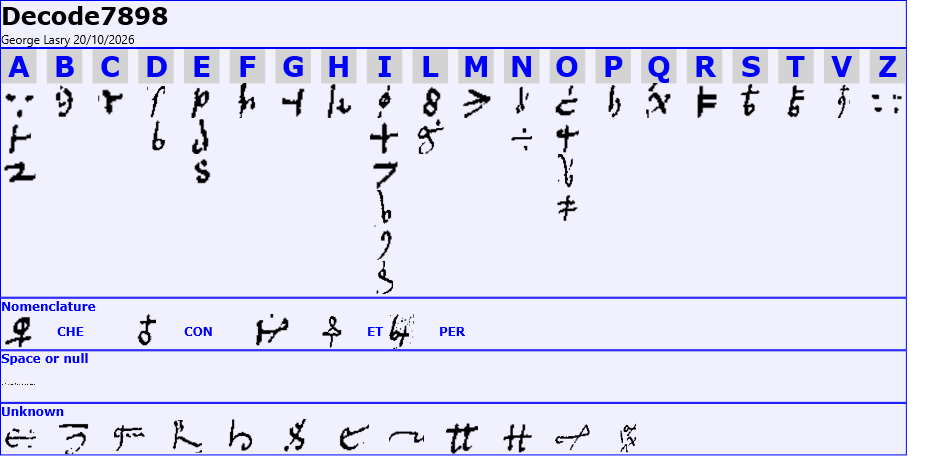
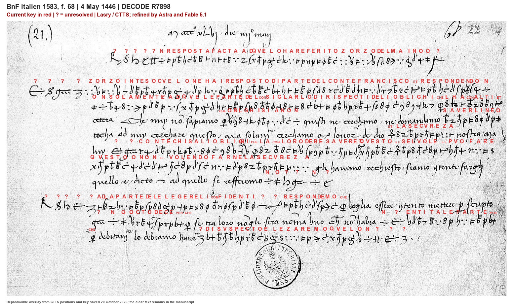

# Reply concerning Zorzo del Maino's report, 4 May 1446

BnF, italien 1583, f. 68 (Archivio Sforzesco); DECODE R7898.

Transcribed by George Lasry with CTTS (CrypTool Transcriber and Solver), who also generated the initial key; the key and reading were improved by Astra and Fable 5.1.

This is a partial decipherment: 399 of 428 cipher occurrences have an assigned value. The unresolved 29 occurrences remain visible throughout the edition. The contribution concerns f. 68 only.

## Key

The current reconstruction has 52 observed cipher classes: 40 with assigned values and 12 unresolved. It combines homophonic letter signs with CHE, CON, ET and PER. The horizontal CTTS snapshot places homophones beneath their plaintext letters. Of 428 cipher occurrences, 399 have an assigned value (93.2% assignment coverage); this is not a measure of independently established accuracy. The ten boxes labelled [Plaintext] mark clear writing and are excluded from these counts.

## Full letter

Bold text was enciphered in the manuscript; regular text was written in clear. All eleven physical text lines and the clear date are included. The reading retains the literal key’s v for u/v and spellings such as qvelo, cvelo and secvreza. Word division, punctuation and solum[ente] are editorial. Each ? represents one unassigned cipher sign. The n and o in the boundary groups are retained literally; their possible function as separators or nulls is not established. The uncertain clear ending of line 5 is marked [aya? …]; the supplied image does not permit its secure completion. The n at the end of line 2 continues as on at the start of line 3.

M°cccc°xlvj die iiij° may [4 May 1446]

1. **? ? ? ? ? n resposta facta ad qvelo ha referito zorzo del maino o ?**

2. **? ? ? ? zorzo inteso cvelo ne hai resposto di parte del conte francisco et respondendo n**

3. **on solamente ad qvele parte del consiglarlo di rispecti de li oblighi che lha con alti et**

4. etcetera. Che nuy no sapiamo **che oblghi siano n** quisti ne cerchamo ne domandamo **saverli ne o**

5. tocha ad nuy cerchare questo, ma solum[ente] cerchamo con l'onor de dio **et la secvreza** nostra [aya? …]

6. luy **? ? conte chi sa li oblighi che la con loro debe savere ? qvesto et se lvole et pvo fare**

7. **qvesto o non et volendo farne la secvreza** gli havemo rechiesto siano contenti farghi

8. quello e dicto, et ad quello se refferemo **n o ? ? n ?**

9. **? ? ? ? ? ad la parte del elegere li confidenti ? ? respondemo che** voglia essere contento mettere per scripto

10. **? n o octo dece per che** se tra loro no gli sera noma uno che no habia **n ?entita le parte per**

11. **che** dubitano lo debiamo hauere **? di svspecto elezaremo qvelo n ? ? ?**

The red overlay is generated directly from the current key and CTTS positions; it replaces older trial readings in the native snapshot. The horizontal key image is the unchanged native CTTS export.

## Historical context

The date in the manuscript reads *M°cccc°xlvj die iiij° may*, 4 May 1446. The deciphered heading names *Zorzo del Maino* and describes a response to what he has reported. [Giuseppe Mazzatinti, inventory (1883), p. 230](https://archive.org/details/archiviostoricol10cava/page/230/mode/2up) independently catalogues f. 68 as a reply concerning Zorzo Maino’s report, “in cifre”. This establishes the occasion, but does not by itself identify the author or the place of dispatch.

The text addresses Zorzo and reports an answer *di parte del conte Francisco*. In this archival setting, the count is very probably Francesco Sforza, but the sender’s collective *nuy* and references to the count in the third person do not justify a firm attribution of authorship to Sforza. The earlier label “Sforza chancery to Zorzo Maino” should therefore remain a hypothesis.

In 1445–1446 Sforza’s position in the Marche was under pressure from Filippo Maria Visconti and papal forces; Florence and Venice had supported him, and conflict also threatened his Cremonese interests. This was a period of shifting obligations and alliances, before Sforza became duke of Milan in 1450. That background helps explain the vocabulary of obligations and security, but does not identify the precise negotiation in this letter. See [Michael E. Mallett, La conquista della Terraferma (1996)](https://www.treccani.it/enciclopedia/la-conquista-della-terraferma_(Storia-di-Venezia)/) and [Antonio Menniti Ippolito, Sforza, Francesco I (2014)](https://www.treccani.it/enciclopedia/francesco-i-sforza_(Enciclopedia-machiavelliana)/).

The readable passages concern the count’s obligations to others, guarantees for “our security”, and the selection of *confidenti*, trusted persons or intermediaries. The writer asks for a written list of eight or ten names (*octo dece*) from which an acceptable person may be chosen. The unresolved signs and the damaged or cropped end of the fifth line limit a continuous interpretation of the whole exchange.

The neighbouring f. 70 is separately catalogued as a letter from Vincenzo Amidani to Francesco Sforza, Milan, 4 May 1446. It is useful archival context, but that letter’s sender and place must not be transferred to f. 68. No reading of f. 70 is claimed here. See [Giuseppe Mazzatinti, inventory (1883), p. 230](https://archive.org/details/archiviostoricol10cava/page/230/mode/2up).

## Findings and uncertainty

Verified refinements include #20 = L (qvelo/qvele), #38 = CON (consiglarlo/confidenti), #10 = Z (zorzo/secvreza), #29 = CHE, #21 = PER, and (5)/(9) = ET. The current transcription distinguishes E from N in del/conte and non/volendo/farne, and uses F in Francisco and P in resposto. Added or corrected boxes support elegere and svspecto. These readings resolve earlier class conflicts without treating every superficially similar glyph as identical.

The twelve unresolved classes are #25, #30, #35, #36, #40, #41, (4), (6), (8), (10), (11) and (16). They account for 29 occurrences, often at passage boundaries. #25 remains unknown even though line 10 permits a tentative ?entita → sentita reading. The pair #40 + (11), following confidenti, is not silently expanded to per. The small elevated (16) mark before qvesto in line 6 may be a correction mark; it is retained and counted until that is established.

Independent checks: every box occurs once in the edited alignment; positions, labels and key values agree with the native exports; the heading's date and subject agree with Mazzatinti's inventory. Historical conclusions above distinguish those observations from attribution hypotheses.

Earlier claims adopted after verification: a broadly correct Lasry key, the Italian reading, CON in confidenti and Z in secvreza. Qualifications to the earlier discussion: #20 gives L, not LL; the current key leaves #25 unresolved; the present F/P and E/N classes no longer require contradictory values. No user decision is required for retaining the uncertain readings explicitly.

## Earlier work and integration

[Bourdeau’s earlier it1583 notes](https://github.com/dbourdeau/cyphersolver/blob/0258b8ab5a039818040a1ee14b6b993cc75a6f71/targets/it1583/NOTES.md) records failed solver runs on an earlier transcription. The present result starts from Lasry’s CTTS transcription and initial key, followed by image checks and contextual corrections. It is an externally contributed partial decipherment; it does not retroactively turn those solver runs into a successful independent solution.

The existing September research notes and generated website files are preserved. `Codex_profile_proposal.json` supplies the complete proposed metadata update for the maintainer to adopt as `targets/it1583/profile.json`; it retains the failed attempts and the separate unread f. 70. It marks this as a contributed result and leaves aggregate reading coverage unknown because the target contains two documents.

## Files and verification

- `ctts/`: positions, palette, key, native transcription and literal decryption, and 52 used cipher icons.
- `edition.json`: every box, current value and cipher/clear segment; `edited.txt`: synchronized eleven-line reading.
- `cipher_tokens.txt`: cipher-only CTTS class IDs; physical lines prefixed L01 through L11.
- `full_letter.md`: complete diplomatic reading with enciphered passages in bold.
- `cryptiana/maino1446.html`: one insertion item; `cryptiana/index.html`: preview; `cryptiana/README.txt`: integration instructions.
- `verify.py`: checks source positions, native exports, key, all edited segments, counts, images and checksums.
- `render_overlay.py`: rebuilds the red overlay from the original image and edition data (Pillow required).
- `manifest.json`: SHA-256 inventory. Source manuscript SHA-256: `0ce37df800bb35bcab31a69b5cade8be334ba47107af5a414b09f78b73dd0db3`.

Run `python targets/it1583/lasry2026/verify.py` from the repository root. Count with `python docs/_check_profile.py --measure targets/it1583/lasry2026/cipher_tokens.txt --drop-first`.

## Sources

- [DECODE R7898](https://de-crypt.org/decrypt-web/RecordsView/7898). Manuscript image and record: Bibliothèque nationale de France, italien 1583, f. 68, Archivio Sforzesco.
- [Giuseppe Mazzatinti, inventory (1883), p. 230](https://archive.org/details/archiviostoricol10cava/page/230/mode/2up). «Inventario delle carte dell’Archivio Sforzesco contenute nei codici italiani 1583–1593 della Biblioteca nazionale di Parigi», Archivio storico lombardo, X (1883), pp. 222–326. The f. 68 entry identifies a reply concerning Zorzo Maino’s report, dated 4 May and in cipher; the separate f. 70 entry identifies Amidani’s letter.
- [Michael E. Mallett, La conquista della Terraferma (1996)](https://www.treccani.it/enciclopedia/la-conquista-della-terraferma_(Storia-di-Venezia)/). Storia di Venezia, section «Conquista ed espansione (1404–1454)»: Sforza, Milan, Venice and Florence in the conflicts of 1443–1446.
- [Antonio Menniti Ippolito, Sforza, Francesco I (2014)](https://www.treccani.it/enciclopedia/francesco-i-sforza_(Enciclopedia-machiavelliana)/). Enciclopedia machiavelliana: Sforza’s position in spring 1446 and his later accession at Milan in 1450.
- [Bourdeau’s earlier it1583 notes](https://github.com/dbourdeau/cyphersolver/blob/0258b8ab5a039818040a1ee14b6b993cc75a6f71/targets/it1583/NOTES.md). The unsuccessful September 2026 attempt, retained as the record of that attempt, not as a review of this contribution.
