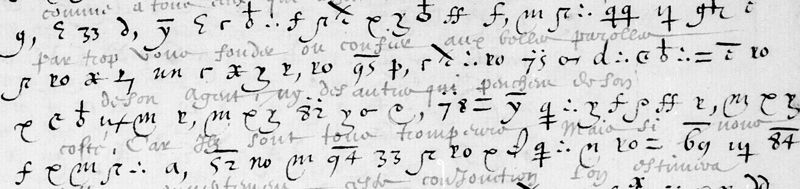

# Français 3516 — Villeroy / royal cipher: excerpt

George Lasry, report PDF `33_francais-3516-villeroy-royal-cipher.pdf`, "Excerpt and Translation".

## Excerpt 1 (f86r, cipher lines8–11)

**comme à tous ceux qui affectionnent ceste union, sans toutefois par trop vous fonder ou confier aux belles parrolles de son agent, ny des autres qui penchent de son coste, car ilz sont tous trompeurs. Mais si nous**
