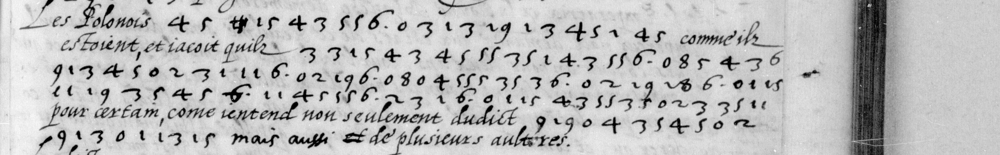
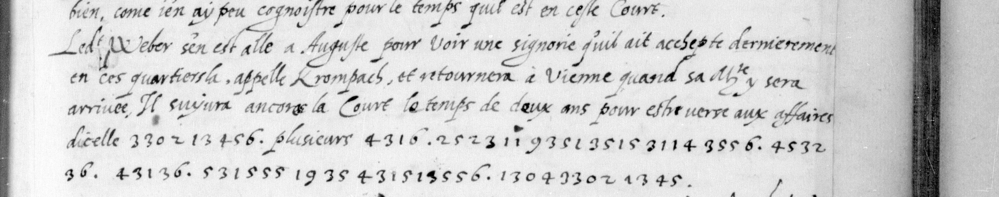

# Français 3198: excerpt

George Lasry, report PDF `02_francais-3198.pdf`, "Excerpt and Translation".

## Excerpt 1 (f63r, passages A21–A23 — 63r)

Les Polonois **sont diuises** comme ilz estoient, et iacoit qu'ilz **monstrent bon uisage au batori aux coeurs est le contraire**, pour certain, comme j'entend non seulement dudict **uuarsauicio** mais aussi de plusieurs aultres.

## Excerpt 2 (f75r, five complete body lines)

Ledict Weber s'en est allé à Auguste pour voir une signorie qu'il ait achepté dernierement en ces quartiers là, appellée Rombals, et retournera à Vienne quand sa Majesté y sera arrivée. Il suivra encores la Court le temps de deux ans pour estre versé aux affaires d'icelle **mais** plusieurs **ne pleureroient s'il n'i** [r]**etourno**[i]**t iamais**.
