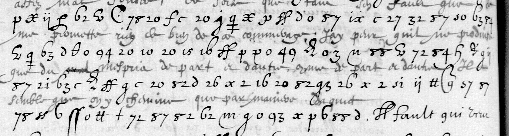

# Français 3516 — La Boderie, f59r–60v: excerpt

George Lasry, report PDF `45_francais-3516-la-boderie-f59r60v.pdf`, "Excerpt and Translation".

## Excerpt 1 (f59v, four full cipher lines)

**assez mal fondees, de sorte que tant s’en faut que je me promette rien de bien de ce commerage. J’ai peur qu’il ne produise que du mespris de part et d’autre, et de part et d’autre il semble que on y chemine que par maniere d’acquit.**
