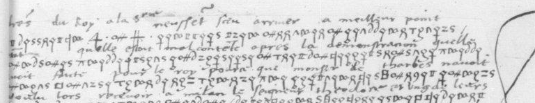

# Français 2971: excerpt

George Lasry, report PDF `30_francais-2971.pdf`, "Excerpt and Translation".

## Excerpt 1 (f32r, cipher lines 1–3)

… **lettres du Roy à Seigneurie n’eussent sceu arriuer à meilleur poinct, aultant qu’elle** [e]**stoit mal contente apres la demonstration qu’elle auoit faicte pour le roi**…
