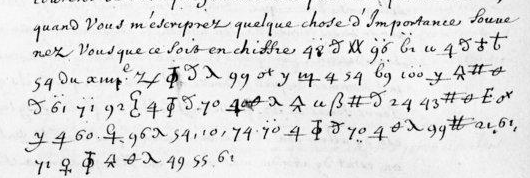

# Français 3758 — Louis XIII, 30 juin 1635: excerpt

George Lasry, report PDF `42_francais-3758-louis-xiii-30-juin-1635.pdf`, "Excerpt and Translation".

## Excerpt 1 (f117r)

Quand vous m’escriprez quelque chose d’importance souvenez vous que ce soit en chiffre. **Car sy la despesche** du xviiᵉ **fust tombée entre les mains des Ennemis, ilz eussent appris [?] et en eussent tiré ?duantage**.
