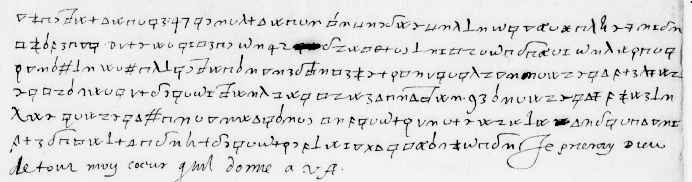
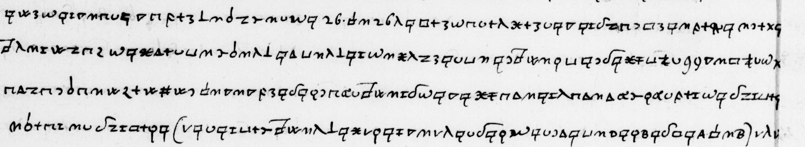
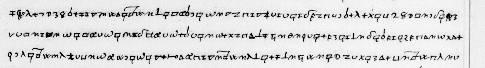
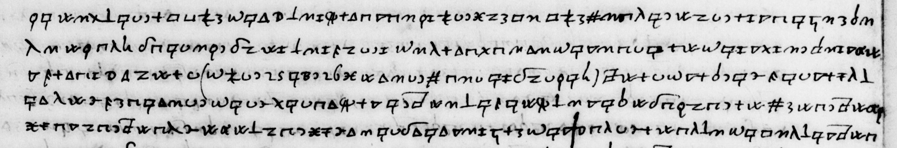
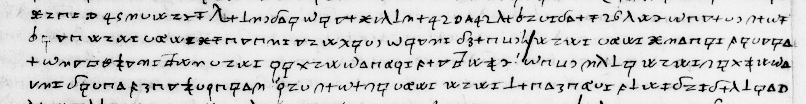
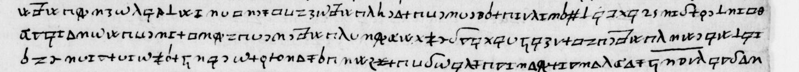

# Italien 2242 — Lucinge, 1588: excerpt

George Lasry, report PDF `07_italien-2242-lucinge-1588.pdf`, "Excerpt and Translation".

## Excerpt 1 (f123r — six complete cipher lines and cleartext closing)

**Soit qu’à ruiner [?] et en la ruine de cettuy celle de son fils y a esté comprise. [?] J’ay un escrit de [?] touchant les conditions de [?]. Ensemble un billet qui me sert de croyance. Je ne l’ose envoyer par la voye commune. J’attends quelque courrier que** **[?]** **m’envoyera pour le luy envoyer bien seurement. Cependant j’en ay voulu retenir ses particularitez, attendant plus sure commodité.** Je prieray Dieu de tout mon cœur qu’il donne à V. A.,

## Excerpt 2 (f131v—cipher lines12–15)

[l]**eur desseing si, par le moyen de [?], de [?], le cardinal Farnese estoit créé pape, et aveq les voix de France y meller celles de Florence, et qu’en cette façon [?] se conduiroit mieux au but de ses prétention, que est de se faire esli**[r]**e roy, non pas de Toscane mais en Toscane (je ne scay quelle finesse il entend entre ce [?]). Il** [v]

## Excerpt 3 (f132v — cipher lines 3–5)

**[?] m’a asseuré que le comte de Soissons n’est point mal avec [?]. Cette princes**[s]**e de Condé est condamnée d’avoir la géhenne après le temps expiré durant lequel l’on ce do**[u]**te de sa groisse qu’elle a aleguée. On verra ce qu’il en…**

## Excerpt 4 (f122v — cipher lines1–5)

**ne veulent accorder. Les Parisiens ont forcé Corbueil et vont assieger Meleun. Ils tienent tous les pons de la riviere de Seine au dessus et dessous Paris. Rouan (dont [?] e[?]t [?] furent bien eastonnés), quand sa Mte y pensa aller, luy prierent de [?] venir pas et que le peuple se mutinoit au bruit qu[?] faisoit qu’il y vouloit fayre entrer ses garde**[s]**. Il n’y a ville de celles qui…**

## Excerpt 5 (f122v — cipher lines25–28)

[Toutes]**fois [?] envoya la lettre de sa fille à [?]. [?] la monstra à [?], luy disant : « Madame, si vous nous faisies souvent de ses traicts, vous nous feries penser à des choses que nous ne voudrions pas. » « Quoy, dict elle, vous me voudries tenir prisonniere ? » « Non Madame, nous vous lairrions plustost aller. »**

## Excerpt 6 (f124r — three full cipher lines)

**u qui perd le plus en cet accord qu'ils traictent mais il semble que [?] estant les ch** **oses reduictes a ce point et qu'il ne pouuoyt se uenger iacoit qu'il eut eu les** **moyens sans domage et danger a mieux faict de laisser passe**[r] **l'orage s'il est re**
