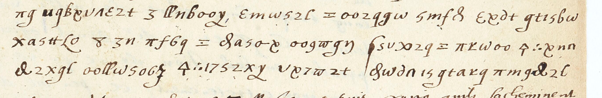
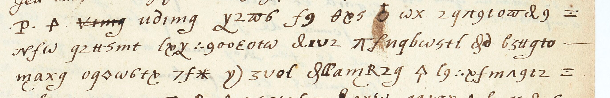

# Dupuy 61 — Méry de Vic, f43r: excerpt

George Lasry, report PDF `01_dupuy-61-mery-de-vic-f43r.pdf`, "Excerpt and Translation".

## Excerpt 1 (f43r)

**? assembler à huict lieues de ceste ville. Leur troupe ? au plus de douze cents hommes? de pied? et deux cents chevaux et doivent meiner deux ou trois pieces.**

## Excerpt 2 (f43r)

**? qui avoit tenu le feu Roy en esperance de le servir, s’est déclaré comme plusieurs du ? m’ont asseuré. Il ? amas d’homes et se delibere de**
