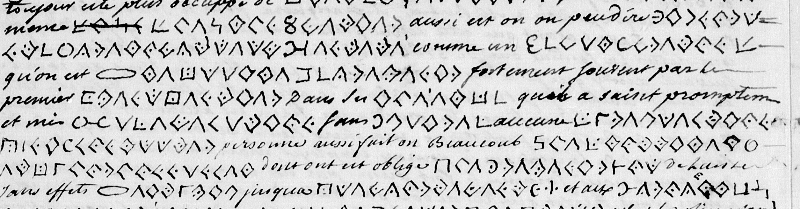
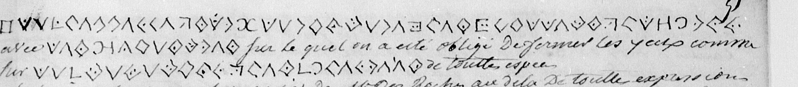
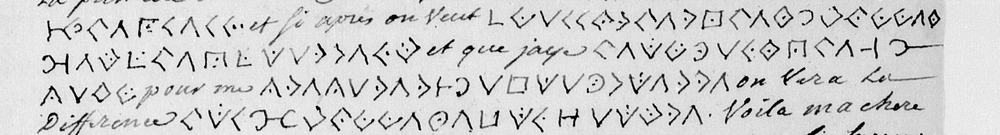

# Français 5581 — Letter from Mondesir: excerpt

George Lasry, report PDF `12_francais-5581-letter-from-mondesir.pdf`, "Excerpt and Translation".

## Excerpt 1 (f50v)

même **de son metier**, aussi est on, on peu dire, **ignorant presomptueux, entete** comme un **bas Breton** qu’on est **[?] se lai[s]se prevenir** fortement souvent par le premier **venu, entier** dans ses **idees** qu'on a saisit promptement et mis **à execution** sans **faire** aucune **reflexion ni consulter** personne. Aussi fait on beaucoup **de sottises et d'ordonnances** dont on est obligé **de revenir ou** de laisser sans effets. **[?] est vif** jusque à **l’emportement** et aux **exces**…

## Excerpt 2 (f51r)

**la deffence sur l’agiotage des billets du Roy** avec **les piastres**, sur lequel on a esté obligé de fermer les yeux comme sur **la taxation des denrees** de toute espece.

## Excerpt 3 (f56r, continuous paragraph, lines3–6 — 56r)

Et si après on veut **maccorder des hommes et de largent** et que jaye **deux ans de paix** pour me **preparer a la guerre** on verra la Différence **du[c/n?] homme e un autre**.
