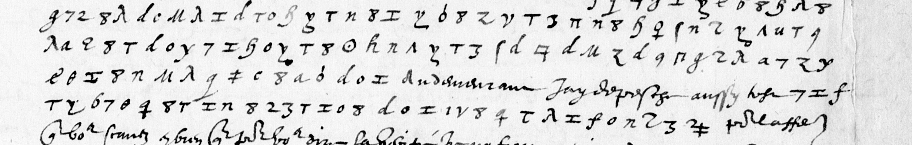

# Français 3622: excerpt

George Lasry, report PDF `15_francais-3622.pdf`, "Excerpt and Translation".

## Excerpt 1 (f91r — four complete body lines)

**facent monstre sur les vieu? rooles parce qu’il y va grand perte. Rasseure le Roy qui l’auroit le tout à la fyn d’avril selon que vous me dites.** Au demeurant, j’ay despesché aussy ? **Asdrubal vers le Corse et eschevyns de Lyon** pour l’affaire
