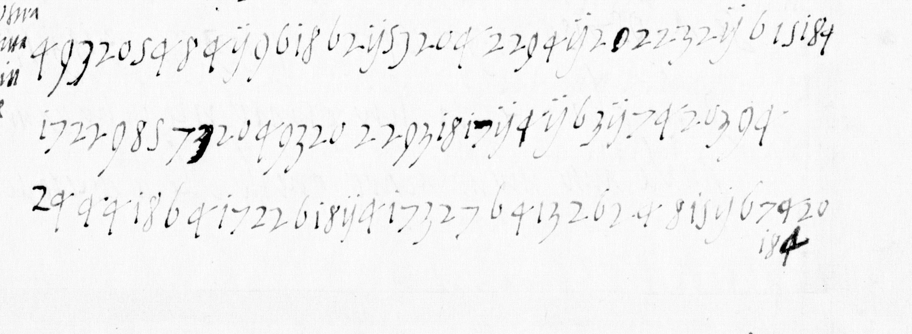

# Français 4687 — ff5v–7v: excerpt

George Lasry, report PDF `10_francais-4687-ff5v7v.pdf`, "Excerpt and Translation".

## Excerpt 1 (f6r, cipher rows 8–10)

**Averia dat volontier a cuatr cento mila scudi per aver cuel stato et pareva ? ascoltase ? parla**
