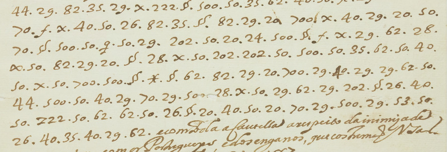

# Portugais 33 — Letter of20April1667: excerpt

George Lasry, report PDF `47_portugais-33-letter-of20april1667.pdf`, "Excerpt and Translation".

## Excerpt 1 (f59r, cipher lines9–15)

**prudencia. Com tudo me pareceo lembrarvos que com aquelle rei se deve trata[r] com todo o segredo por que os Olandezes se nam dem por ofendidos.**
