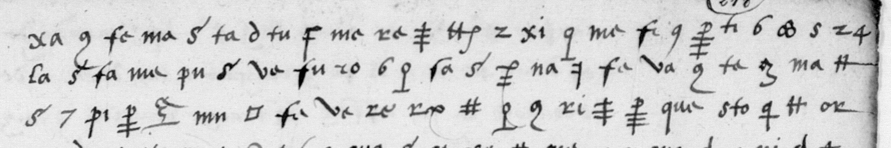

# Français 20991 — Renard, ff217v–218r: excerpt

George Lasry, report PDF `54_francais-20991-renard-ff217v218r.pdf`, "Excerpt and Translation". His excerpt is the historical decipherment of f218r lines 1–3 (not in bold in the PDF), set against the cipher lines 1–3; added by hand, the extractor missed it (24 Oct 2026).

## Excerpt 1 (f218r, lines 1–3 — historical decipherment)

[de Sel]va et de Lansac. Sur lequel advis led[it] s[ieu]r Roy manda querir le nonce du pappe estant pardeçà, et se plaignit à luy de ces desseins, et qu’il trou[voit].
