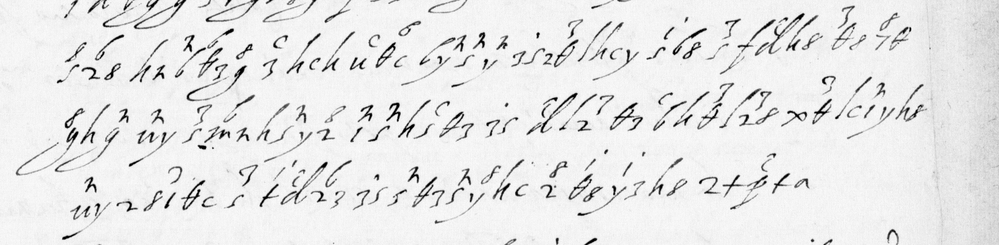

# Français 3613 — Rondinelli, ff62r–v: excerpt

George Lasry, report PDF `14_francais-3613-rondinelli-ff62rv.pdf`, "Excerpt and Translation".

## Excerpt 1 (f62r, full cipher lines 15–17)

**… dalla necessita io non posso credere che l signor duca di Mena sia bastante per difenderla, uedendosi che egli si consiglia et si gouerna per l'auiso di quelli che desiderano la sua ruina.**
