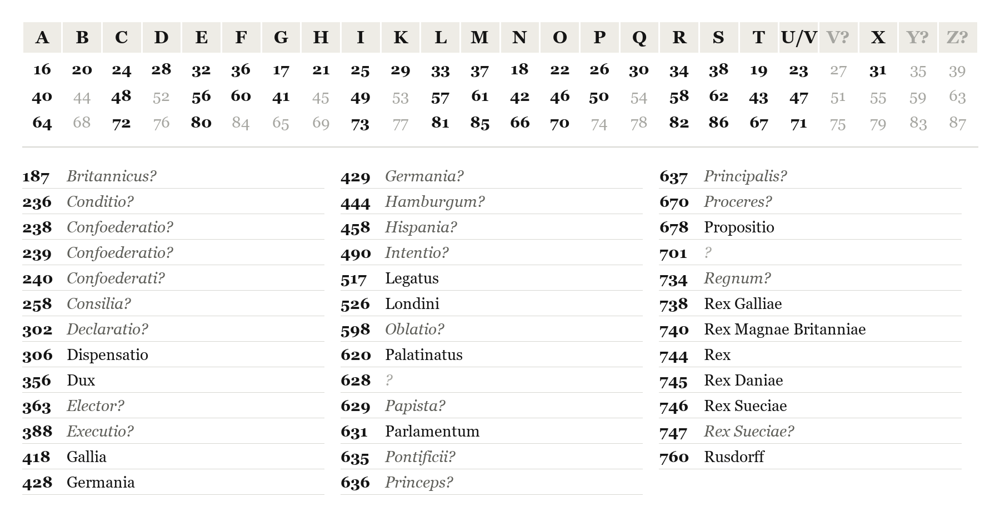
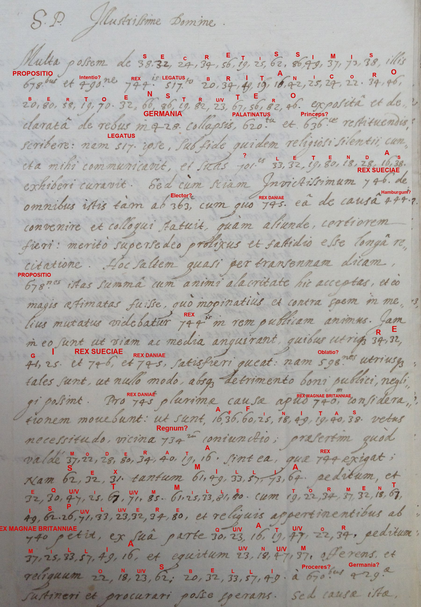
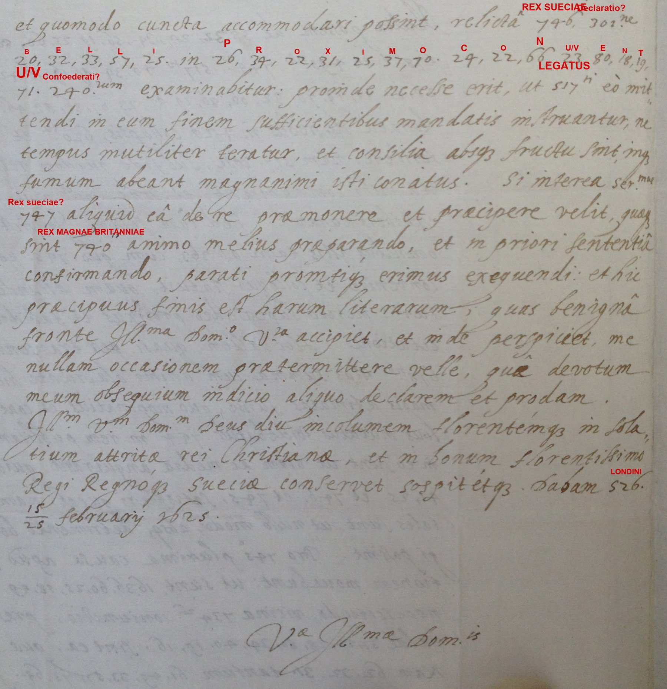
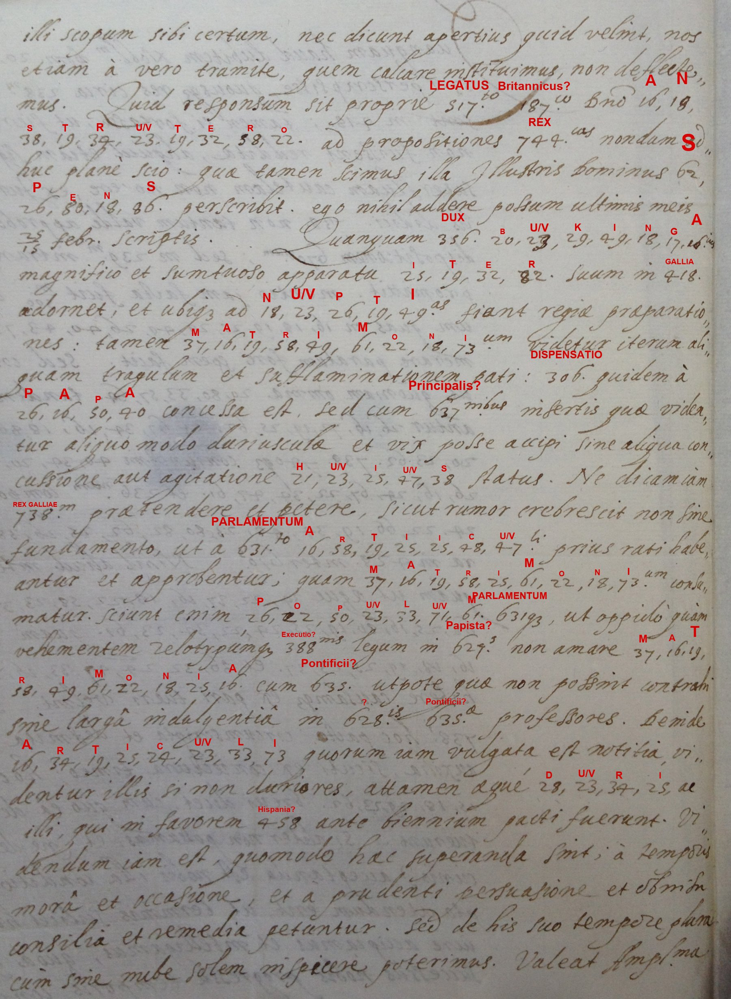
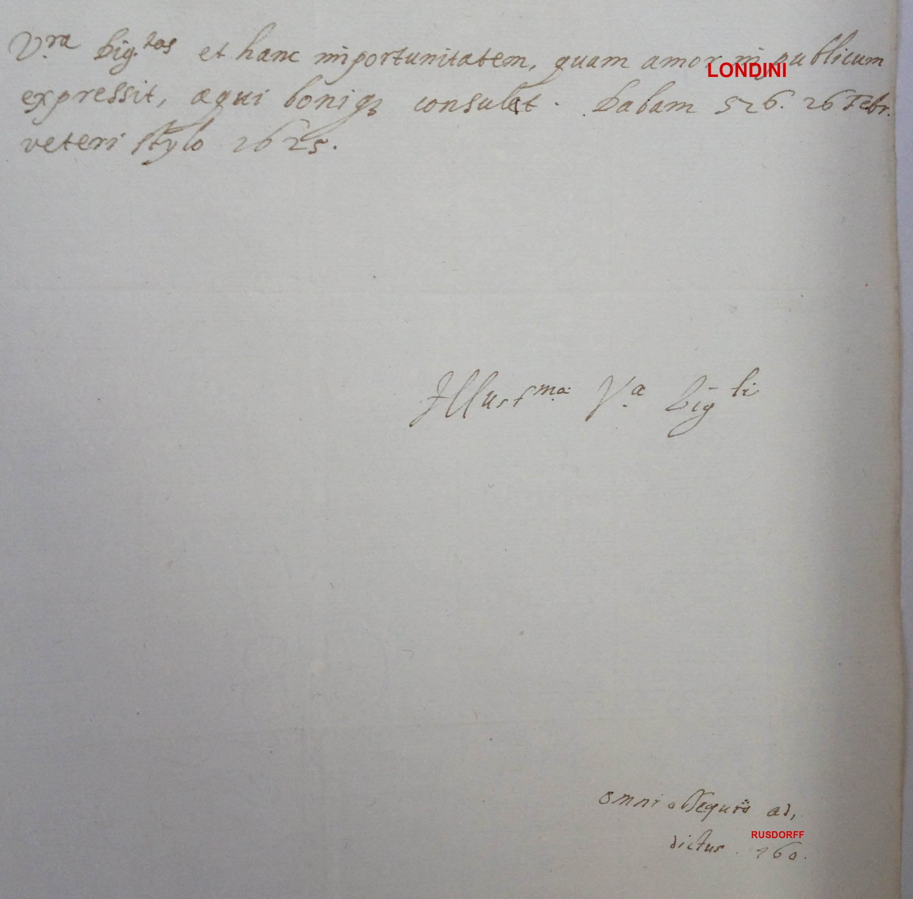
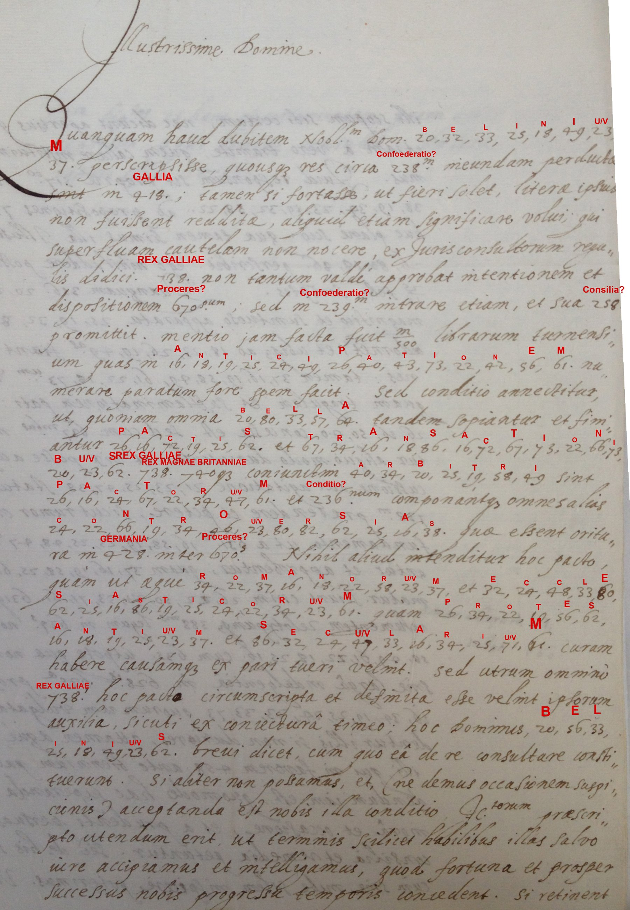

# Johann Joachim von Rusdorff to Axel Oxenstierna, London, February 1625

**Reference.** Riksarkivet (Swedish National Archives), Oxenstierna af Södermöre, Ser. B, E 701; [DECODE R4336](https://de-crypt.org/decrypt-web/RecordsView/4336) (2 images) and [DECODE R4337](https://de-crypt.org/decrypt-web/RecordsView/4337) (3 images). Cyphersolver target `rusdorff1628`.

**Solved by George Lasry.** Transcribed with CTTS (CrypTool Transcriber and Solver); initial key from CTTS's built-in cryptanalysis; the three-digit nomenclator codes recovered with Claude Opus 5.5.

The two DECODE records contain three letters from Rusdorff, the Palatine envoy in London, to the Swedish chancellor Axel Oxenstierna. All five images are read: 376 enciphered letters (all assigned) and 62 three-digit codes (36 occurrences confident, 24 tentative, 2 unknown). The letters are dated in London, 15/25 February and 26 February (old style) 1625, not The Hague 1628 as catalogued.

## Summary of contents

**Letter 1 (R4336, images 1–2; London, 15/25 February 1625).** Rusdorff has been shown the secret Swedish propositions laid before the British envoy Sir Robert Anstruther for the restoration of the Palatinate. London received them eagerly, as James I now seems more inclined to the common cause, and seeks to satisfy both the King of Sweden and the King of Denmark. Christian IV's terms are modest: he asks King James for 6,000 foot and 1,000 horse with artillery and powder, and offers 4,000 foot and 1,000 horse himself. The matter is to be settled at the next meeting of the confederates, for which envoys need full powers.

**Letter 2 (R4337, images 1–2; London, 26 February 1625 old style; the first page is not among the photographs).** The answer to Anstruther is still unknown; Sir James Spens will report it. Buckingham is preparing a magnificent journey to France for the royal wedding, but the marriage meets new obstacles. The papal dispensation came with harsh clauses, the King of France reportedly wants Parliament to ratify the articles first, and people and Parliament dislike Catholic marriages. Signed by Rusdorff.

**Letter 3 (R4337, image 3; beginning of a further letter, undated).** The Brandenburg agent Christian Bellin will have reported how far the confederation had advanced in France. The King of France approves and promises to join, with 500,000 livres tournois in advance, on condition that he and the King of Great Britain jointly arbitrate the settlement of all disputes in Germany, for Catholics and Protestants alike. Rusdorff advises accepting the condition with suitable safeguards.

## The key

The cipher combines a homophonic letter table with a one-part nomenclator. The 24 letters each have three two-digit homophones exactly **24 apart** (A = 16, 40, 64). Consecutive letters lie **4 apart** in runs of six (A–F 16–36, G–M 17–37, N–S 18–38, T–Z 19–39), so each new run starts one higher (F→G, M→N, S→T: +5 mod 24). 23 serves for both U and V; the theoretical V (27), Y (35) and Z (39) are not used in these letters. The three-digit codes are in **alphabetical order** of their meanings (187 Britannicus? … 760 Rusdorff), which was used to check every reading.

Bold codes in the letter table occur in the letters; grey ones follow from the 24-step rule. In the code list, italics with ? are tentative, and ? alone is unknown.

## Reading conventions

**Bold** = originally enciphered (letters or codes); regular = written in clear. [code:reading?] = tentative code; [code?] = unknown code. Abbreviations are kept as written.

## Letter 1 — R4336, images 1–2 (London, 15/25 February 1625)

### Latin

S.P. Illustrissime Domine,

Multa possem de **secretissimis** illis **propositionibus** et **[490:intentione?]** **Regis** **Legato Britannico Roberto Enstrutero** exposita et declarata de rebus in **Germania** collapsis, **Palatinatu** et **[636:Principe?]** restituendis, scribere: nam **Legatus** ipse, sub fide quidem religiosi silentii, cuncta mihi communicavit, et suas **[701?]**es **le(g)endas** exhiberi curavit. Sed cum sciam Invictissimum **Regem Sueciae** de omnibus istis tam ab **[363:Electore?]**, cum quo **Rex Daniae** ea de causa **[444:Hamburgi?]** convenire et colloqui statuit, quam aliunde, certiorem fieri, merito supersedeo prolixus et fastidio esse longa recitatione. Hoc saltem quasi per transennam dicam, **propositiones** istas summa cum animi alacritate hic acceptas, et eo magis aestimatas fuisse, quo inopinatius et contra spem in melius mutatus videbatur **Regis** in rem publicam animus. Jam in eo sunt ut viam ac media anquirant, quibus utrique **regi**, et **Sueciae** et **Daniae**, satisfieri queat: nam **[598:oblationes?]** utriusque tales sunt, ut nullo modo, absque detrimento boni publici, negligi possint. Pro **Rege Daniae** plurimae causae apud **Regem Magnae Britanniae** considerationem movebunt, ut sunt **affinitas** vetus, necessitudo, vicina **[734:regnorum?]** coniunctio; praesertim quod valde **moderata** sint ea, quae **Rex** exigat. Nam **sex** tantum **millia** peditum et **equitum mille** cum **tormentis, pulvere** et reliquis appertinentibus ab **Rege Magnae Britanniae** petit, ex sua parte **quatuor** peditum **millia** et equitum **unum** offerens, et reliquum **onus belli** a **[670:Proceribus?]** **[429:Germaniae?]** sustineri et procurari posse sperans.

Sed causa ista, et quomodo cuncta accommodari possint, relicta **Regis Sueciae** **[302:declaratione?]**, **belli** in **proximo conventu** **[240:Confoederatorum?]** examinabitur: proinde necesse erit, ut **Legati** eo mittendi in eum finem sufficientibus mandatis instruantur, ne tempus inutiliter teratur, et consilia absque fructu sint, in fumum abeant magnanimi isti conatus. Si interea Ser.mus **[747:Rex Sueciae?]** aliquid ea de re praemonere et praecipere velit, quae sint **Regis Magnae Britanniae** animo melius praeparando et in priori sententia confirmando, parati promtique erimus exequendi: et hic praecipuus finis est harum literarum, quas benigna fronte Ill.ma Dom.o V.ra accipiet, et inde perspiciet me nullam occasionem praetermittere velle, qua devotum meum obsequium indicio aliquo declarem et prodam. Ill.m V.m Dom.m Deus diu incolumem florentemque in solatium attritae rei Christianae et in bonum florentissimo Regi Regnoque Sueciae conservet sospitetque. Dabam **Londini** 15/25 februarii 1625.

V.a Ill.ma Dom.is [the subscription continues beyond the photographed page]

### English translation

S.P. Most illustrious Lord,

I could write much about those **most secret propositions** and the **[intention?]** of the **King**, set out and declared to the **British envoy Robert Anstruther**, concerning the affairs that have collapsed in **Germany** and the restoration of the **Palatinate** and its **[Prince?]**: for the **envoy** himself, under the pledge of religious silence, communicated everything to me and had his **[701?]** shown to me to **read**. But since I know that the most invincible **King of Sweden** will be informed of all this both by the **[Elector?]**, with whom the **King of Denmark** has resolved to meet and confer on this matter at **[Hamburg?]**, and from elsewhere, I rightly refrain from being prolix and from wearying you with a long account. This much I will say, as if through a lattice: those **propositions** were received here with the greatest eagerness, and were valued all the more because the **King's** disposition towards the common cause seemed, unexpectedly and against hope, to have changed for the better. They are now seeking a way and means to satisfy both **kings**, of **Sweden** and of **Denmark**, for the **[offers?]** of each are such that they cannot be neglected without harm to the public good. In favour of the **King of Denmark** many reasons will weigh with the **King of Great Britain**: the old **kinship**, close relationship, the neighbouring union of the **[kingdoms?]**; above all, that what the **King** asks is very **moderate**. For he asks of the **King of Great Britain** only **six thousand** foot and **a thousand horse**, with **artillery, powder** and the other appurtenances, offering on his own part **four thousand** foot and **one thousand** horse, and hoping that the rest of the **burden of the war** can be borne and provided for by the **[princes?]** of **[Germany?]**.

But this business, and how everything can be accommodated, setting aside the **King of Sweden's** **[declaration?]**, will be examined at the **next meeting** of the **[Confederates?]** on the **war**: so the **envoys** to be sent there must be furnished with sufficient powers for that purpose, lest time be wasted, the deliberations come to nothing, and these magnanimous efforts end in smoke. If in the meantime his Serene Majesty the **[King of Sweden?]** wishes to advise or direct anything on this, which might serve to prepare the mind of the **King of Great Britain** better and to confirm him in his earlier view, we shall be ready and prompt to carry it out. And this is the chief purpose of this letter, which Your Most Illustrious Lordship will receive with a kindly countenance, and from it perceive that I wish to let pass no opportunity of declaring and showing my devoted service by some token. May God long preserve Your Most Illustrious Lordship safe and flourishing, for the comfort of the worn-down Christian cause and for the good of the most flourishing King and Kingdom of Sweden. Given at **London**, 15/25 February 1625.

Your Most Illustrious Lordship's [the subscription continues beyond the photographed page]

## Letter 2 — R4337, images 1–2 (London, 26 February 1625, old style)

### Latin

[The beginning of the letter is not among the photographs.] … illi scopum sibi certum, nec dicunt apertius quid velint; nos etiam a vero tramite, quem calcare instituimus, non deflectemus. Quid responsum sit proprie **Legato** **[187:Britannico?]** D.no **Anstrutero** ad propositiones **Regias**, nondum adhuc plane scio: quae tamen scimus, illa Illustris Dominus **Spens** perscribit; ego nihil addere possum ultimis meis 25/15 febr. scriptis.

Quanquam **Dux** **Bukinga**[m] magnifico et sumtuoso apparatu **iter** suum in **Galliam** adornet, et ubique ad **nupti**as fiant regiae praeparationes, tamen **matrimoni**um videtur iterum aliquam tragulum et sufflaminationem pati: **Dispensatio** quidem a **Papa** concessa est, sed cum **[637:principalibus?]** insertis, quae videantur aliquo modo duriuscula et vix posse accipi sine aliqua concussione aut agitatione **huius** status; ne dicam iam **Regem Galliae** praetendere et petere, sicut rumor crebrescit non sine fundamento, ut a **Parlamento** **arti(i)cu**li prius ratihabeantur et approbentur, quam **matrimoni**um consumatur. Sciunt enim **populum** **Parlamentum**que, ut oppido quam vehementem zelotypiamque **[388:executionis?]** legum in **[629:Papistas?]**, non amare **matrimonia** cum **[635:Pontificiis?]**, utpote quae non possint contrahi sine larga indulgentia in **[628?]**is **[635:Pontificiae?]** professores. Deinde **articuli**, quorum iam vulgata est notitia, videntur illis, si non duriores, attamen aeque **duri** ac illi, qui in favorem **[458:Hispaniae?]** ante biennium pacti fuerunt. Dicendum iam est, quomodo haec superanda sint: a tempore, mora et occasione, et a prudenti persuasione et Domin[…] consilia et remedia petuntur. Sed de his suo tempore plura, cum sine nube solem inspicere poterimus.

Valeat Ampl.ma V.ra Dig.tas, et hanc importunitatem, quam amor in publicum expressit, aequi bonique consulat. Dabam **Londini** 26 Febr. veteri stylo 1625.

Illus.ma V.a Dig.ti omni obsequio addictus **Rusdorff**

### English translation

[The beginning of the letter is not among the photographs.] … they have a fixed aim and do not say more openly what they want; we too shall not turn aside from the true path we have resolved to tread. What exactly has been answered to the **[British?] envoy**, Lord **Anstruther**, on the **royal** propositions, I do not yet clearly know; what we do know, the illustrious Lord **Spens** is reporting in full, and I can add nothing to my last letter of 15/25 February.

Although **Duke Buckingham** is preparing his **journey** to **France** with magnificent and costly display, and royal preparations for the **wedding** are being made everywhere, the **marriage** nevertheless seems once again to meet some snag and delay. The **dispensation** has indeed been granted by the **Pope**, but with **[principal?]** clauses inserted that seem somewhat harsh and hardly acceptable without some shock or disturbance to **this** state; not to mention that the **King of France** now claims and demands, as rumour increasingly reports, and not without foundation, that the **articles** first be ratified and approved by **Parliament** before the **marriage** is consummated. For they know that the **people** and **Parliament**, most vehemently zealous as they are for the **[execution?]** of the laws against the **[Papists?]**, do not love **marriages** with **[Catholics?]**, since these cannot be contracted without broad indulgence towards those who profess the **[628?]** **[Catholic?]** religion. Moreover, the **articles**, whose content is already publicly known, seem to them, if not harsher, at least as **harsh** as those agreed two years ago in favour of **[Spain?]**. How these difficulties are to be overcome must now be said: counsel and remedies are sought from time, delay and opportunity, and from prudent persuasion and the Lord[…] … More on this in due course, when we can look at the sun without clouds.

Farewell, Your Most Ample Dignity, and take in good part this importunity, which love for the common cause has drawn from me. Given at **London**, 26 February, old style, 1625.

Your Most Illustrious Dignity's, devoted with all obedience, **Rusdorff**

## Letter 3 — R4337, image 3 (beginning of a further letter, undated)

### Latin

Illustrissime Domine,

Quanquam haud dubitem Nobil.m Dom. **Belinium** perscripsisse, quousque res circa **[238:Confoederationem?]** ineundam perducta sint in **Gallia**, tamen si fortasse, ut fieri solet, literae ipsius non fuissent redditae, aliquid etiam significare volui, qui superfluam cautelam non nocere ex Jurisconsultorum regulis didici. **Rex Galliae** non tantum valde approbat intentionem et dispositionem **[670:Procerum?]**, sed in **[239:Confoederationem?]** intrare etiam, et sua **[258:consilia?]** promittit. Mentio jam facta fuit m/500 librarum turnensium, quas in **anticipationem** numerare paratum fore spem facit. Sed conditio annectitur, ut, quoniam omnia **bella** tandem sopiantur et finiantur **pactis** et **transactionibus**, **Rex Galliae** **Rex Magnae Britanniae**que coniunctim **arbitri** sint **pactorum** et **[236:conditionum?]**, componantque omnes alias **controversias**, quae essent oritura[e] in **Germania** inter **[670:Proceres?]**. Nihil aliud intenditur hoc pacto, quam ut aeque **Romanorum** et **ecclesiasticorum** quam **protes(t)antium** et **secularium** curam habere causamque ex pari tueri velint. Sed utrum omnino **Galli** hoc pacto circumscripta et definita esse velint ipsorum auxilia, sicuti ex coniectura timeo, hoc Dominus **Belinius** brevi dicet, cum quo ea de re consultare constituerunt. Si aliter non possumus, et ne demus occasionem suspicionis, acceptanda est nobis illa conditio; JC.torum praescripto utendum erit, ut terminis scilicet habilibus illas salvo iure accipiamus et intelligamus, quod fortuna et prosper successus nobis progressu temporis concedent. Si retinent … [continues beyond the photographed page]

### English translation

Most illustrious Lord,

Although I do not doubt that the noble Lord **Bellin** has written in full how far matters concerning entering into the **[Confederation?]** have been brought in **France**, yet in case his letters, as often happens, have not been delivered, I wished to report something too, having learnt from the rules of the jurists that superfluous caution does no harm. The **King of France** not only warmly approves the intention and disposition of the **[princes?]**, but also promises to enter the **[Confederation?]**, and offers his **[counsels?]**. Mention has already been made of 500,000 livres tournois, which he gives hope he will be ready to pay in **advance**. But a condition is attached: that, since all **wars** are at last settled and ended by **treaties** and **agreements**, the **King of France** and the **King of Great Britain** should jointly be **arbiters** of the **treaties** and **[conditions?]**, and settle all other **disputes** that might arise in **Germany** among the **[princes?]**. Nothing else is intended by this arrangement than that they should be willing to care for, and defend on equal terms, the cause of the **Roman** and **ecclesiastical** as much as of the **Protestant** and **secular** estates. But whether the **French** really wish their help to be circumscribed and defined in this way, as I conjecture and fear, Lord **Bellin**, with whom they have decided to consult on this matter, will soon tell. If we cannot do otherwise, and so as not to give occasion for suspicion, we must accept that condition; we shall follow the prescription of the jurists, accepting and understanding the terms in suitable form, without prejudice to our rights, as fortune and prosperous success will grant us in the course of time. If they retain … [continues beyond the photographed page]

## Historical context

Johann Joachim von Rusdorff (1589–1640) was the envoy of the exiled Elector Palatine Frederick V in London from 1622 to 1627. His correspondence with Axel Oxenstierna, which runs from 1624 to 1628, survives in his manuscript collections and is largely unpublished; this is why these letters are in the Oxenstierna archive. The three letters are dated in London, in February 1625, in the last weeks of James I's reign (he died on 27 March/6 April 1625). The catalogue date "The Hague, 1628" does not apply to them.

The letters belong to the negotiations of 1624–1625 for a Protestant coalition to recover the Palatinate. Both Gustavus Adolphus and Christian IV of Denmark offered to lead an army in Germany. Letter 1 explains why the Danish offer weighed more in London: kinship (Anne of Denmark), proximity, and modest terms. The coalition that followed was the Hague alliance of December 1625 between England, Denmark and the United Provinces, without Sweden. Sir Robert Anstruther was the British envoy to Denmark and the German princes; Sir James Spens, also named in Letter 2, served both James I and Gustavus Adolphus.

Letter 2 concerns the French marriage of Prince Charles and Henrietta Maria. The papal dispensation arrived with conditions favouring English Catholics, and Buckingham was preparing to fetch the bride (he went to Paris in May 1625). Parliament and the public feared that the marriage articles would suspend the penal laws, as the Spanish-match articles of 1623 had promised. Letter 3 reports French support for the confederation, subsidies of 500,000 livres and a French–English arbitration for Germany. It names Christian Bellin, the agent who reported on the coalition to Berlin.

## How the key was obtained

The five images were transcribed in CTTS: each two-digit group, three-digit code and clear word was boxed and labelled, and each clear-text stretch was boxed as its own plaintext segment. The letter homophones were recovered by CTTS's built-in cryptanalysis and completed with the 24-step rule, which every code in the letters confirms. The three-digit codes were then recovered with Claude Opus 5.5 from their contexts and the Latin endings written beside them (‑is, ‑to, ‑bus, ‑m). The alphabetical order of the nomenclator served as a check: every reading lies alphabetically between its solved neighbours. Doubtful glyphs and endings were checked against the images.

## Open points

- Unknown codes: 628 (between Palatinatus and Papista), 701 (between Propositio and Regnum).
- Tentative codes: 24 occurrences, marked with ? in the text and the key.
- Letter 2 lacks its first page, and the subscription of Letter 1 and the remainder of Letter 3 are not on these photographs.
- R4333–R4335 (the other Rusdorff letters in the target) are not covered by this contribution.

## Sources

- D. Bourdeau, cyphersolver target `rusdorff1628`: [NOTES.md](https://github.com/dbourdeau/cyphersolver/blob/20690ae3/targets/rusdorff1628/NOTES.md) (survey, archival identification, volume E 701).
- Riksarkivet, Oxenstierna af Södermöre, Ser. B, E 701; DECODE records [R4336](https://de-crypt.org/decrypt-web/RecordsView/4336) and [R4337](https://de-crypt.org/decrypt-web/RecordsView/4337).
- [*Johann von Rusdorf, kurpfälzischer Gesandter und Staatsmann während des dreissigjährigen Krieges*](https://archive.org/details/bub_gb_3NwPAAAAYAAJ) (1876): Rusdorff's London embassy, his correspondence with Oxenstierna (1624–1628), Christian Bellin.
- J. J. von Rusdorff, *Mémoires et négociations secrètes*, ed. E. W. Cuhn, vol. 1 (1789), [Ossolineum digital library](https://leopolitana.ossolineum.pl/uk/dlibra/publication/2607/edition/2123): the London embassy; not searched for these letters.
- J. J. von Rusdorff, *Consilia et negotia politica*, ed. J. M. von Loen (1725): checked, does not contain these letters.
- Riksarkivet, [Letters of Sir James Spens to Axel Oxenstierna 1613–1630](https://sok.riksarkivet.se/en/oxenstierna/jakob-spens) (online edition of AOSB II:13): the same negotiations from Spens's side; not yet compared.

## Files

`targets/rusdorff1628/lasry2026/`:

- `ctts/`: the CTTS project (key, colors, positions, transcription, decryption and edited exports, icons).
- `cryptiana/`: a Cryptiana item (`rusdorff1625.html`, scoped `rusdorff1625.css`, standalone `index.html`, images).
- `profile_proposal.json`: proposed profile entries for R4336 and R4337.

Images of the documents are not committed beyond the reduced decryption overlays.

## Credit

Please credit **George Lasry** (`lasry`) for the solution and transcription. Tools: CTTS (transcription and initial key), Claude Opus 5.5 (three-digit codes, reading and translation).
