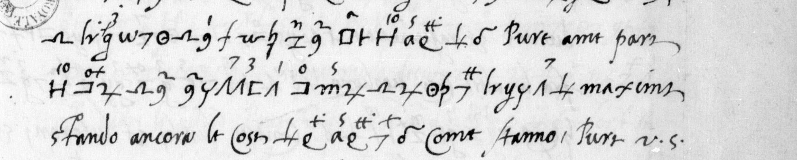

# Français 2933: excerpt

George Lasry, report PDF `09_francais-2933.pdf`, "Excerpt and Translation".

## Excerpt 1 (f54r — complete lines 13–15)

**e bisogniera trovare qualche modo [?]** Pure a me pare **che l’essere restituita la possessione basti [?]** maxime. Stando ancora le cose **[?] di Modena [?]** come stanno hora, V.S.…
