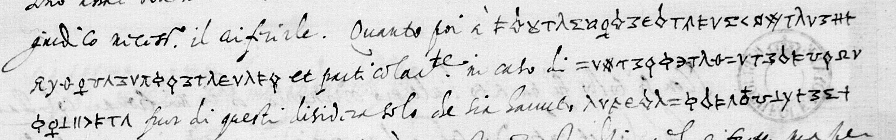

# Français 4696 / 4698 — graphical cipher, ff5r/62r–v, ff30r–: excerpt

George Lasry, report PDF `18_francais-4696-4698-graphical-cipher-ff5r-62rv-ff30r31r-and-f104r.pdf`, "Excerpt and Translation".

## Excerpt 1 (f62v, three complete body lines5–7)

giudico ? il aiutarle. Quanto poi a **la persona sva egli si ?ferisce prontisimo a servirla** et particolar[men]te in caso di **difesa o vero di esaltatione di lei**, fuor di questi ? solo de sua salute, **ri**[gu]**ardo al interesse**
