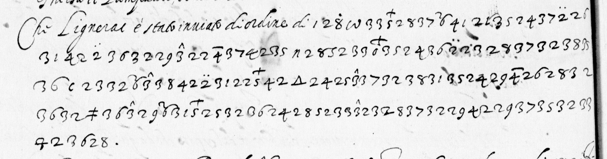

# Français 3613 — Sega, ff148r–v: excerpt

George Lasry, report PDF `16_francais-3613-sega-ff148rv.pdf`, "Excerpt and Translation".

## Excerpt 1 (f148v, complete enciphered passage and cleartext opening)

Che Lignerac è stato inuiato d'ordine di **Umena in Poitu et Bretagna a solecitar la impresa di Tours per doue ua anco a questi efeto un religioso acciò se l uno fose impedito l altro pasi.**
